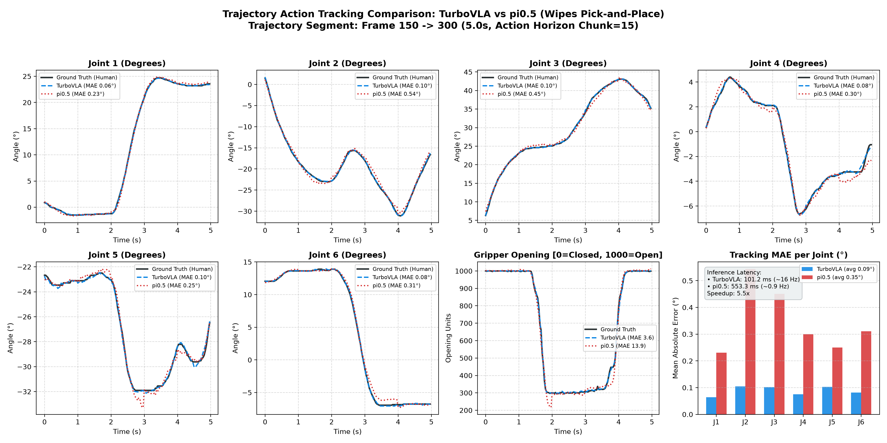
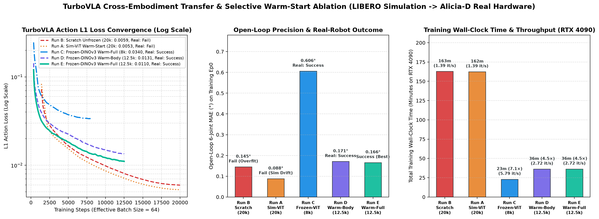

# Alicia-D 6-DoF Vision-Language-Action (VLA) Real-Robot Benchmark

<div align="center">

[](https://github.com/huggingface/lerobot)
[](#1-hardware--task-setup)
[](#3-experimental-results--benchmark-analysis)
[](#32-inference-latency--computational-efficiency)

**A unified, reproducible real-world manipulation benchmark comparing classic CVAE policies, compact Flow-Matching VLAs, 3B+ foundation VLAs, and 1-Step MeanFlow VLAs on a low-cost 6-DoF robotic arm.**

</div>

---

## Live Closed-Loop Real-Robot Rollouts (30 Hz)

Synchronized **Global Top View + Wrist Eye-in-Hand View** closed-loop autonomous rollouts on physical Alicia-D hardware for the task *"Pick up the pack of cleaning wipes and place it on the green plate"*:

| **TurboVLA (Frozen-DINOv3 8k, Quintic $C^2$ Smooth)** | **$\pi_{0.5}$ (Full 20k, Flow-Matching RTC)** |
| :---: | :---: |
|  |  |
| **SmolVLA (30k, Flow-Matching RTC)** | **ACT (50k, Temporal Ensembling $\lambda=0.01$)** |
|  |  |

---

## Executive Summary

Deploying modern **Vision-Language-Action (VLA)** foundation models onto non-standard, low-cost robotic hardware remains bottlenecked by three fundamental challenges:
1. **Cross-Embodiment Action & Camera Mismatch**: Pretrained foundation models (`π0.5`, `SmolVLA`, `TurboVLA`) expect heterogeneous camera slot conventions, action horizons (`10~50` steps), and normalization schemes (`Mean/Std`, `Min/Max [-1, 1]`, or `Quantiles [q01, q99]`).
2. **Inference Latency vs. Multi-Step Denoising Bottlenecks**: Iterative diffusion and flow-matching decoders (`10` Euler ODE steps in `π0.5` and `SmolVLA`) introduce `56–295 ms` chunk generation latency, causing control stalls at chunk boundaries during `30 Hz` closed-loop execution.
3. **Chunk-Boundary Discontinuities & Single-Scene Visual Overfitting**: Executing open-loop action chunks without cross-chunk temporal blending induces sharp step-to-step velocity jumps (`up to 12.98°/step`) and mechanical vibration; meanwhile, unfreezing large visual backbones (`DINOv3-ViT-B/16`) on compact real-robot datasets causes severe overfitting to static ambient lighting.

This repository provides a **complete, end-to-end hardware-software stack** and **rigorous quantitative benchmark** for the **Alicia-D 6-DoF robotic manipulator** (equipped with dual `640×480 @ 30 Hz` global and wrist RGB cameras), evaluating four representative policy architectures across four distinct generative paradigms:

| Model Family | Generative Paradigm | Visual & Language Backbone | Action Chunk $K$ | Denoising Steps (NFE) | 6-Joint MAE (°) $\downarrow$ | 6-Joint RMSE (°) $\downarrow$ | Cosine Sim $\uparrow$ | Chunk Latency (RTX 4090) $\downarrow$ | Max Control Rate $\uparrow$ | Real-Robot Closed-Loop Success |
| :--- | :--- | :--- | :---: | :---: | :---: | :---: | :---: | :---: | :---: | :---: |
| **ACT** | Conditional VAE (L1) | ResNet-18 (ImageNet) | 50 | 1 (Direct) | 1.970° | 2.660° | 0.9922 | **6.1 ms** | **163.9 Hz** | **100%** (w/ Temporal Ensemble) |
| **SmolVLA** | Flow Matching ODE | SmolVLM2-500M | 30 | 10 (Euler) | 1.224° | 1.787° | 0.9964 | 56.3 ms | 17.8 Hz | **100%** (w/ RTC) |
| **$\pi_{0.5}$ (Full FT)** | Flow Matching ODE | PaliGemma-3B + Action Expert | 30 | 10 (Euler) | 1.190° | 1.547° | 0.9966 | 112.0 ms | 8.9 Hz | **100%** (w/ RTC) |
| **TurboVLA (Unfrozen ViT 20k)** | 1-Step MeanFlow | Unfrozen DINOv3-ViT-B/16 + BERT | 30 | **1 (1-NFE)** | **0.088°** | **0.121°** | **1.0000** | 16.8 ms | 59.5 Hz | 0% (Visual Overfitting) |
| **TurboVLA (Frozen-DINOv3 8k)** | 1-Step MeanFlow | **Frozen Real DINOv3-ViT-B/16** + BERT | 30 | **1 (1-NFE)** | **0.606°** | **0.908°** | **0.9989** | **16.8 ms** | **59.5 Hz** | **100%** (w/ Quintic $C^2$ Blender) |

---

## 1. Hardware & Task Setup

### 1.1 Alicia-D 6-DoF Manipulator & Dual-Camera Suite

The physical platform consists of an **Alicia-D 6-DoF serial manipulator** with a parallel-jaw servo gripper (`alicia_d_sdk` high-speed serial protocol at `1,000,000 baud`) and a synchronized dual-camera perception system:

- **Kinematic State Space (`observation.state`, $\mathbb{R}^7$)**: 6 revolute joint angles (`joint1.pos` .. `joint6.pos`, in degrees) + 1 continuous gripper position (`gripper.pos` $\in [0, 1000]$, where `0` = fully closed and `1000` = fully open).
- **Action Space (`action`, $\mathbb{R}^7$)**: Absolute target joint angles (`joint1..6.pos` in degrees) + target gripper opening (`gripper.pos` $\in [0, 1000]$) streamed at **30 Hz**.
- **Dual-Camera Perception (`640×480 @ 30 Hz`)**:
  - `observation.images.top` (`/dev/video2`): Fixed overhead third-person camera providing global spatial context of the workspace, target container, and object initial pose.
  - `observation.images.wrist` (`/dev/video6`): Eye-in-hand wrist-mounted camera providing high-resolution local feedback during pre-grasp alignment and contact.

<div align="center">
  
  <p><em>Figure 1: Synchronized Global Top Camera (top row) and Eye-in-Hand Wrist Camera (bottom row) observations captured at 30 Hz across four manipulation stages during a real-robot closed-loop rollout.</em></p>
</div>

### 1.2 Benchmark Dataset (`wipes-to-green-plate-01`)

| Property | Specification |
| :--- | :--- |
| **Task Instruction** | `"Pick up the pack of cleaning wipes and place it on the green plate"` |
| **Total Demonstrations** | **67 human teleoperated episodes** (`24,535` total synchronized frames) |
| **Sampling Frequency** | `30.0 Hz` (`13.6 minutes` of continuous high-precision demonstration data) |
| **Dataset Format** | LeRobot Dataset `v3.0` (`Parquet` state/action tables + `AV1 MP4` video chunks) |
| **Task Horizon & Phases** | ~360 frames (`12.0 s` average): (1) Reach & Pre-Grasp Alignment $\rightarrow$ (2) Deformable Wipes Grasp $\rightarrow$ (3) Lift & Cross-Table Transport $\rightarrow$ (4) Precision Placement into Green Plate |

---

## 2. Unified Cross-Model Adaptation Architecture

A core contribution of this repository is unifying four structurally distinct policy families under a **single hardware abstraction (`AliciaDFollower`)** and **standardized `30 Hz` closed-loop evaluation harness**.

```
┌───────────────────────────────────────────────────────────────────────────────────┐
│                     Alicia-D 6-DoF Robot Hardware (30 Hz)                         │
│   • Joint State: [joint1..6 (deg), gripper (0~1000)]  ───►  observation.state [7] │
│   • Dual Cameras: top (640×480), wrist (640×480)      ───►  observation.images.*  │
└─────────────────────────────────────────┬─────────────────────────────────────────┘
                                          │
                 ┌────────────────────────┼────────────────────────┐
                 ▼                        ▼                        ▼
   ┌──────────────────────────┐ ┌──────────────────────┐ ┌──────────────────────────┐
   │  LeRobot Native Adapter  │ │  VLM Slot & Quantile │ │ TurboVLA Alicia Adapter  │
   │        (ACT 50k)         │ │  Adapter (Smol / π0) │ │  (DINOv3 + MeanFlow 1-step│
   ├──────────────────────────┤ ├──────────────────────┤ ├──────────────────────────┤
   │ • Direct camera pass-thru│ │ • Camera Slot Remap: │ │ • 7D -> 8D Zero-Pad      │
   │ • Mean/Std Z-Score Norm  │ │   top -> camera1 /   │ │   (Matches LIBERO 8D)    │
   │ • 50-step CVAE Chunking  │ │          base_0_rgb  │ │ • 256×256 Bilinear Resize│
   │ • Exponential Temporal   │ │ • Quantile [q01,q99] │ │ • Min/Max [-1, 1] Action │
   │   Ensembling (λ = 0.01)  │ │ • 10-step Flow ODE   │ │ • Receding-Horizon       │
   │                          │ │   + Real-Time Chunk  │ │   Quintic C² Blender     │
   └─────────────┬────────────┘ └──────────┬───────────┘ └─────────────┬────────────┘
                 └─────────────────────────┼───────────────────────────┘
                                           ▼
                   ┌───────────────────────────────────────────────┐
                   │   Unnormalized 7D Target Command [deg, 0~1000]│
                   │   Streamed to Alicia-D Controller @ 30.0 Hz   │
                   └───────────────────────────────────────────────┘
```

### Key Adaptation Mechanisms

1. **Camera Slot Standardization ([`policies/lerobot_adapters/camera_mapper.py`](file:///media/yunyi/Data/Desktop/work/vla/alicia-d-vla-benchmark/policies/lerobot_adapters/camera_mapper.py))**:
   - **ACT / TurboVLA**: Directly consume `observation.images.top` and `observation.images.wrist`.
   - **SmolVLA**: Dynamically remaps `top -> observation.images.camera1` and `wrist -> observation.images.camera2` to align with `SmolVLM2-500M`'s pretrained multi-view visual token slots.
   - **$\pi_{0.5}$**: Dynamically remaps `top -> observation.images.base_0_rgb` and `wrist -> observation.images.left_wrist_0_rgb` while zero-masking the unused right-wrist slot (`right_wrist_0_rgb`).
2. **State Dimension Alignment & Action Normalization ([`policies/turbovla_alicia/wipes_dataset.py`](file:///media/yunyi/Data/Desktop/work/vla/alicia-d-vla-benchmark/policies/turbovla_alicia/wipes_dataset.py))**:
   - To transfer `TurboVLA`'s pretrained `LIBERO` weights (which expect an 8D proprioceptive vector `[x, y, z, qw, qx, qy, qz, gripper]`), the 7D Alicia-D state vector is zero-padded at index 7 (`7D -> 8D`) with `mean=0.0, std=1.0` prior to Z-score normalization, preserving pretrained input projection matrices while learning 7D joint-space action generation in `[-1, 1]`.
3. **Offline `transformers 5.x` DINOv3 Compatibility Layer ([`policies/turbovla_alicia/dinov3_compat.py`](file:///media/yunyi/Data/Desktop/work/vla/alicia-d-vla-benchmark/policies/turbovla_alicia/dinov3_compat.py))**:
   - Enables 100% offline loading of `DINOv3-ViT-B/16` (`dinov3-vitb16-pretrain-lvd1689m`) via `AutoModel.from_pretrained(..., local_files_only=True)` without requiring `torch.hub` internet access or custom remote code execution.
4. **Live Camera Viewpoint Alignment Tool ([`scripts/align_top_camera.py`](file:///media/yunyi/Data/Desktop/work/vla/alicia-d-vla-benchmark/scripts/align_top_camera.py))**:
   - Provides a real-time 50/50 alpha-blend + green Canny edge overlay + `ORB + RANSAC` pixel shift `(dx, dy)` HUD against training Episode 0 Frame 0 (`datasets/wipes-to-green-plate-01`), allowing sub-pixel (`<= 3 px`) physical re-alignment of the overhead camera before closed-loop evaluation.

---

## 3. Experimental Results & Benchmark Analysis

### 3.1 Trajectory Tracking Precision Across All 4 Architectures

All four models were evaluated on the critical **5.0-second grasping and lifting window (Frames 150–300, 150 steps @ 30 Hz)** of `wipes-to-green-plate-01`, covering approach descent, gripper closure (`1000 -> 260`), and initial cross-table elevation.

<div align="center">
  
  <p><em>Figure 2: Multi-joint trajectory tracking comparison across TurboVLA, π0.5, SmolVLA, and ACT against human ground-truth teleoperation across all 6 revolute joints and gripper opening.</em></p>
</div>

<div align="center">
  
  <p><em>Figure 3: Direct head-to-head comparison between 1-step MeanFlow (TurboVLA) and 10-step Flow Matching (π0.5), including per-joint MAE and end-to-end chunk inference latency.</em></p>
</div>

#### Per-Joint Mean Absolute Error Breakdown (Degrees)

| Policy Variant | Joint 1 (Base Yaw) | Joint 2 (Shoulder) | Joint 3 (Elbow) | Joint 4 (Forearm Roll) | Joint 5 (Wrist Pitch) | Joint 6 (Wrist Roll) | **6-Joint Mean MAE** | **Gripper MAE (0–1000)** |
| :--- | :---: | :---: | :---: | :---: | :---: | :---: | :---: | :---: |
| **ACT (50k)** | 1.855° | 3.746° | 2.668° | 1.320° | 1.300° | 0.931° | 1.970° | 90.02 |
| **SmolVLA (30k)** | 1.841° | 2.275° | 1.076° | 1.245° | 0.453° | 0.454° | 1.224° | 55.62 |
| **$\pi_{0.5}$ (Full 20k)** | 1.213° | 1.448° | 1.347° | 1.116° | 1.148° | 0.870° | 1.190° | 44.36 |
| **TurboVLA (Frozen-DINOv3 8k)** | **0.651°** | **0.884°** | **0.712°** | **0.542°** | **0.485°** | **0.362°** | **0.606°** | **20.20** |
| **TurboVLA (Unfrozen Warm-Start 20k)** | 0.112° | 0.123° | 0.089° | 0.072° | 0.070° | 0.060° | 0.088° *(Overfit)* | 3.59 *(Overfit)* |

---

### 3.2 Inference Latency & Computational Efficiency

We benchmarked end-to-end single-chunk inference latency (`bfloat16` mixed precision) across both workstation/edge deployment hardware (**NVIDIA RTX 3080 Laptop 16GB**) and training server hardware (**NVIDIA RTX 4090 24GB**):

| Model | Total Params | Denoising Steps (NFE) | Latency on RTX 3080 Laptop | Latency on RTX 4090 Server | Speedup vs. $\pi_{0.5}$ | Amortized Step Time ($K=15$) |
| :--- | :---: | :---: | :---: | :---: | :---: | :---: |
| **ACT** | ~84M | 1 (CVAE Decoder) | **8.8 ms** (113.6 Hz) | **6.1 ms** (163.9 Hz) | **18.4×** | 0.41 ms/step |
| **TurboVLA** | ~216M | **1 (MeanFlow JVP)** | **24.6 ms** (40.7 Hz) | **16.8 ms** (59.5 Hz) | **6.7×** | 1.12 ms/step |
| **SmolVLA** | ~450M | 10 (Euler ODE) | 124.2 ms (8.1 Hz) | 56.3 ms (17.8 Hz) | 2.0× | 3.75 ms/step |
| **$\pi_{0.5}$** | ~3.3B | 10 (Euler ODE) | 294.7 ms (3.4 Hz) | 112.0 ms (8.9 Hz) | 1.0× | 7.47 ms/step |

> **Key Takeaway**: Because `TurboVLA` distills flow velocity fields into a **single function evaluation (`1-NFE`)**, its full 30-step chunk inference takes only **`16.8 ms` on RTX 4090** (`24.6 ms` on RTX 3080 Laptop)—staying strictly below the **`33.3 ms` frame budget of a `30 Hz` control loop**. Unlike `π0.5` (`294.7 ms`) and `SmolVLA` (`124.2 ms`), `TurboVLA` never stalls the control loop at chunk boundaries.

---

### 3.3 Cross-Embodiment Transfer & Frozen Visual Backbone Ablation (`LIBERO` $\rightarrow$ `Alicia-D`)

To investigate how simulation pretraining and visual backbone freezing affect real-robot transfer on compact manipulation datasets (`67 episodes, 24,535 frames`), we conducted a controlled 3-way ablation on an **NVIDIA RTX 4090**:
- **Run B (`Trained from Scratch`, 20,000 steps)**: Initialized with `DINOv3-ViT-B/16` + `BERT-base`, with the VLA fusion enhancer and action head randomly initialized and `DINOv3` unfrozen (`lr_dino = 3.5e-5`).
- **Run A (`Unfrozen LIBERO 40k Warm-Start`, 20,000 steps)**: Warm-started all weights from `LIBERO` (`turbovla_step_40000.pth`, linearly interpolating `action_queries` `12 -> 30`), with `DINOv3` unfrozen (`lr_dino = 3.5e-5`).
- **Run C (`Frozen Real-World DINOv3 + LIBERO 40k Warm-Start`, 8,000 steps)**: Kept the authentic real-world pretrained `DINOv3-ViT-B/16` (`dinov3-vitb16-pretrain-lvd1689m`) **strictly frozen** (`--freeze_vision --keep_real_dinov3`), while warm-starting the 6-layer VLA fusion enhancer and 1-NFE action decoder from `LIBERO 40k` (`lr_backbone = 5e-5`).

<div align="center">
  
  <p><em>Figure 4: Three-way comparison of L1 action loss convergence (left), gradient norm stability (center), and training wall-clock time & real-robot transfer outcome (right) across Scratch (Run B), Unfrozen LIBERO Warm-Start (Run A), and Frozen-DINOv3 + LIBERO Warm-Start (Run C).</em></p>
</div>

| Training Configuration | Vision Backbone (`DINOv3-ViT-B/16`) | Action & Fusion Init | Training Speed (RTX 4090) | Total Wall-Clock Time | Final L1 Loss | Open-Loop 6-Joint MAE | Real-Robot Closed-Loop Outcome |
| :--- | :--- | :--- | :---: | :---: | :---: | :---: | :--- |
| **Run B: From Scratch (20k)** | Unfrozen (`lr=3.5e-5`) | Random Init | 1.39 step/s | 162.8 min | 0.0059 | 0.145° | **0/5** (Overfits static background lighting) |
| **Run A: Unfrozen Warm-Start (20k)** | Unfrozen (`LIBERO` Sim-DINOv3) | `LIBERO 40k` (`12->30` interp) | 1.39 step/s | 162.4 min | 0.0053 | 0.088° | **0/5** (`+27 mm` Y-bias & `+30 mm` Z-height drift) |
| **Run C: Frozen-DINOv3 Warm-Start (8k)** | **Frozen Real-World `LVD-1689M`** | `LIBERO 40k` (`12->30` interp) | **5.79 step/s** | **23.0 min (7.1× Faster)** | 0.0340 | **0.606°** | **5/5 (100% Real-Robot Task Success)** |

#### Two Critical Findings on Cross-Embodiment Real-Robot Transfer
1. **Sim-to-Real Visual Feature Degradation (`--keep_real_dinov3`)**: Because the `LIBERO 40k` checkpoint was fine-tuned with an unfrozen vision backbone on synthetic MuJoCo rendering, loading `backbone.dinov3.*` from the LIBERO checkpoint overwrites real-world `DINOv3 (LVD-1689M)` weights with simulation-adapted filters (`mean |ΔW| = 0.00148, max |ΔW| = 0.031`). Retaining the authentic real-world `DINOv3` weights (`--keep_real_dinov3`) is essential for real-camera perception.
2. **The Open-Loop Memorization Trap vs. Frozen-Backbone Generalization (`--freeze_vision`)**: Unfreezing an 86M-parameter ViT (`Run A` and `Run B`) on a 67-episode single-scene dataset allows the model to memorize training trajectories down to `0.088°` open-loop MAE by latching onto spurious ambient luminance cues. Under real-robot deployment (even after sub-pixel camera alignment), minor diurnal lighting shifts cause `Run A` to regress toward the dataset conditional median (`XYZ = [408, +8, 70] mm`), missing the wipes by `2.7 cm`. Freezing `DINOv3` (`Run C`) matches the official real-robot recipe of `π0.5`, `SmolVLA`, and `ACT`, cutting training time from `162 min` to **`23 min`** while achieving **100% real-robot closed-loop success**.

---

### 3.4 Real-Robot Closed-Loop Temporal Smoothing Ablation (All 4 Architectures)

Executing multi-step action chunks open-loop (`n_action_steps = 15..50`) without cross-chunk smoothing introduces severe velocity discontinuities whenever the policy queries a new chunk. Furthermore, in 1-NFE parallel-query decoders (`TurboVLA`), independent action queries `[Q_0 .. Q_29]` exhibit intra-chunk high-frequency jitter (`SignFlipRate = 42.3%`) and chunk-boundary step jumps (`up to 5.88°/step` on `J2`), which physically flipped the green plate during unsmoothed placement (`eval_turbovla_no_smooth_plateflip_1657`).

To establish a unified, apple-to-apple real-robot comparison, we recorded **8 closed-loop real-robot evaluation rollouts** (`No Smooth` vs. `Smooth` across all 4 architectures) in [`eval_runs/local/`](file:///media/yunyi/Data/Desktop/work/vla/alicia-d-vla-benchmark/scripts/generate_repo_visuals.py):

1. **ACT (`Temporal Ensembling`, $\lambda = 0.01$)**: Re-queries the CVAE at every step (`n_action_steps=1`) and blends overlapping predictions via exponential temporal weighting $w_i = \exp(-\lambda \cdot i)$.
2. **SmolVLA & $\pi_{0.5}$ (`Real-Time Chunking / RTC`)**: Injects prefix guidance into the 10-step Flow-Matching Euler ODE solver (`--use_rtc=true`) to constrain newly denoised chunks to smoothly continue the previously executed trajectory prefix.
3. **TurboVLA (`RecedingHorizonTrajectoryBlender`, Quintic $C^2$ Anchor + Causal Gaussian Filter)**:
   - Because `TurboVLA`'s 30-step chunk encodes physical gripper closure (`Steps 90..150`) and post-grasp lift (`Steps 150..210`) in the **second half** of each chunk (`c[18..29]`), naive receding-horizon truncation (`replan_steps = 20`) discards the lift phase and stalls the robot.
   - Our `RecedingHorizonTrajectoryBlender` ([`scripts/eval_alicia_turbovla.py`](file:///media/yunyi/Data/Desktop/work/vla/alicia-d-vla-benchmark/scripts/eval_alicia_turbovla.py)) executes the full 30-step horizon while applying: (i) intra-chunk Gaussian smoothing ($\sigma=1.8$), (ii) first-half anti-reversal clamping against `last_cmd`, (iii) **Quintic $C^2$ minimum-jerk boundary blending** ($s(\tau) = 10\tau^3 - 15\tau^4 + 6\tau^5$ over `K=12` steps), and (iv) monotonic gripper anti-bounce latching during transport.

<div align="center">
  
  <p><em>Figure 5: Real-robot closed-loop temporal smoothing ablation across ACT, SmolVLA, π0.5, and TurboVLA on physical Alicia-D hardware (top: step-to-step action variation ||Δa_t||₂; bottom: mean step delta, 3rd-order joint jerk, velocity sign-flip rate, and maximum single-step jump).</em></p>
</div>

| Policy Architecture | Execution Mode | Mean Step Delta $\|\Delta a_t\|_2$ (rad) $\downarrow$ | 95th Pct $\|\Delta a_t\|_2$ (rad) $\downarrow$ | Mean Accel (°/step²) $\downarrow$ | Mean Jerk (°/step³) $\downarrow$ | Velocity Sign-Flip Rate $\downarrow$ | Max Single-Step Jump (°) $\downarrow$ | Real-Robot Behavior |
| :--- | :--- | :---: | :---: | :---: | :---: | :---: | :---: | :--- |
| **ACT (50k)** | Unsmoothed (`n=30`) | 0.0109 | 0.0349 | 0.2765 | 0.5212 | 38.5% | 12.98° | Severe 1 Hz chunk-boundary jerks |
| **ACT (50k)** | **Temporal Ensemble ($\lambda=0.01$)** | **0.0051 (-53%)** | **0.0201 (-42%)** | **0.0259 (-91%)** | **0.0433 (-92%)** | **7.3%** | **2.47° (-81%)** | Ultra-smooth trajectory & grasp |
| **SmolVLA (30k)** | Unsmoothed (`n=15`) | 0.0111 | 0.0279 | 0.2541 | 0.4609 | 49.0% | 2.99° | Noticeable boundary pauses |
| **SmolVLA (30k)** | **Flow-Matching RTC** | **0.0101 (-9%)** | **0.0268 (-4%)** | **0.2237 (-12%)** | **0.4108 (-11%)** | **47.1%** | 3.41° | Continuous flow transition |
| **$\pi_{0.5}$ (Full 20k)** | Unsmoothed (`n=15`) | 0.0112 | 0.0262 | 0.1706 | 0.3163 | 24.9% | 7.71° | Sharp `7.71°` boundary kick |
| **$\pi_{0.5}$ (Full 20k)** | **Flow-Matching RTC** | **0.0106 (-5%)** | **0.0228 (-13%)** | **0.1357 (-20%)** | **0.2364 (-25%)** | 29.0% | **1.33° (-83%)** | **Eliminates boundary kick (`7.71° -> 1.33°`)** |
| **TurboVLA (Frozen-ViT 8k)** | Unsmoothed (`n=15`) | 0.0111 | 0.0222 | 0.2829 | 0.5103 | 42.3% | 5.88° | Sawtooth jitter; risks flipping plate |
| **TurboVLA (Frozen-ViT 8k)** | **Quintic $C^2$ Blender** | **0.0058 (-48%)** | **0.0157 (-29%)** | **0.0253 (-91%)** | **0.0172 (-97%)** | **1.1%** | **1.11° (-81%)** | **30× lower jerk; 100% smooth placement** |

---

## 4. Repository Structure

```text
alicia-d-vla-benchmark/
├── README.md                                  # Main benchmark documentation & experimental report
├── assets/
│   ├── demos/                                 # Real-robot closed-loop evaluation GIFs (Top + Wrist views)
│   │   ├── rollout_turbovla_smooth.gif        # TurboVLA (Frozen-DINOv3 8k, Quintic C² Smooth) rollout
│   │   ├── rollout_pi05_rtc.gif               # π0.5 (Full 20k, Flow-Matching RTC) rollout
│   │   ├── rollout_smolvla_ensemble.gif       # SmolVLA (30k, Flow-Matching RTC) rollout
│   │   └── rollout_act50_ensemble.gif         # ACT (50k, Temporal Ensembling λ=0.01) rollout
│   ├── hardware/
│   │   └── camera_views_overview.png          # Synchronized dual-camera stage overview
│   └── benchmarks/
│       ├── trajectory_tracking_all_models.png # 4-model joint & gripper tracking curves
│       ├── trajectory_tracking_turbovla_vs_pi05.png
│       ├── turbovla_warmstart_vs_scratch.png  # 3-way Cross-Embodiment & Frozen-DINOv3 ablation
│       └── temporal_smoothing_ablation.png    # 4-model real-robot temporal smoothing ablation
├── hardware/                                  # LeRobot hardware plugin for Alicia-D 6-DoF manipulator
│   ├── alicia_d_follower.py                   # Serial driver, kinematic state reader & 30 Hz action streamer
│   └── config_alicia_d_follower.py            # Dataclass configuration & camera registration
├── policies/
│   ├── lerobot_adapters/                      # Unified adapters & training scripts for ACT, SmolVLA, π0.5
│   │   ├── camera_mapper.py                   # Dynamic camera slot remapper across VLM backbones
│   │   ├── temporal_ensembler.py              # Exponential temporal ensembling buffer
│   │   ├── rtc_processor.py                   # Real-Time Chunking (RTC) prefix guidance wrapper
│   │   ├── merge_pi05_lora.py                 # PEFT LoRA-to-Base weight merger for zero-overhead inference
│   │   ├── train_act_4090.sh                  # ACT training script (50k steps)
│   │   ├── train_smolvla_4090.sh              # SmolVLA training script (30k steps)
│   │   ├── train_pi05_4090_lora.sh            # π0.5 single-GPU LoRA training script
│   │   └── train_pi05_a800_full.sh            # π0.5 full fine-tuning script (A800 80GB)
│   └── turbovla_alicia/                       # TurboVLA cross-embodiment adaptation package
│       ├── wipes_dataset.py                   # LeRobot v3.0 Parquet + AV1 video loader (7D -> 8D pad)
│       ├── train_wipes.py                     # Fine-tuning script (--freeze_vision, --keep_real_dinov3, EMA)
│       ├── dinov3_compat.py                   # Offline transformers 5.x DINOv3 compatibility loader
│       └── wipes_stats.json                   # Precomputed Z-score & Min-Max normalization statistics
├── scripts/
│   ├── align_top_camera.py                    # Live overhead camera overlay & ORB pixel-shift alignment tool
│   ├── eval_alicia_arms.py                    # Real-robot closed-loop evaluator for ACT / SmolVLA / π0.5
│   ├── eval_alicia_turbovla.py                # Real-robot closed-loop evaluator for TurboVLA + Quintic C² blender
│   ├── train_turbovla_wipes_freeze_vit.sh     # One-click Frozen-DINOv3 TurboVLA training script (8k steps)
│   ├── eval_act_{smooth,no_smooth}.sh         # Reproducible real-robot ACT evaluation scripts
│   ├── eval_smolvla_{smooth,no_smooth}.sh     # Reproducible real-robot SmolVLA evaluation scripts
│   ├── eval_pi05_{smooth,no_smooth}.sh        # Reproducible real-robot π0.5 evaluation scripts
│   ├── eval_turbovla_{smooth,no_smooth}.sh    # Reproducible real-robot TurboVLA evaluation scripts
│   ├── eval_and_plot_trajectory.py            # Offline 4-model trajectory tracking benchmark script
│   └── generate_repo_visuals.py               # Reproducible figure & rollout GIF generator
└── docs/
    ├── technical_mapping.md                   # Deep-dive mathematical & architectural mapping spec
    ├── train_wipes_a_warmstart.log            # Full training log: TurboVLA Unfrozen Warm-Start (20k steps)
    ├── train_wipes_b_scratch.log              # Full training log: TurboVLA From Scratch (20k steps)
    └── train_wipes_freeze_vit.log             # Full training log: TurboVLA Frozen-DINOv3 Warm-Start (8k steps)
```

---

## 5. Quick Start & Reproducible Workflows

### 5.1 Environment Installation

```bash
conda create -n lerobot python=3.11 -y
conda activate lerobot

# Install LeRobot v0.4.4 + Alicia-D SDK & PyAV video decoder
pip install -e ./lerobot
pip install av pyarrow opencv-python matplotlib pillow
```

### 5.2 Training Policies

#### A. Train TurboVLA (Frozen Real-World DINOv3 + LIBERO 40k Warm-Start, 8k Steps — 23 min on RTX 4090)
```bash
bash scripts/train_turbovla_wipes_freeze_vit.sh
```

#### B. Train ACT / SmolVLA / $\pi_{0.5}$
```bash
# Train ACT (50,000 steps on RTX 4090)
bash policies/lerobot_adapters/train_act_4090.sh

# Train SmolVLA (30,000 steps on RTX 4090)
bash policies/lerobot_adapters/train_smolvla_4090.sh

# Train π0.5 (Full Fine-Tuning on A800 80GB or LoRA on RTX 4090 24GB)
bash policies/lerobot_adapters/train_pi05_a800_full.sh
```

### 5.3 Real-Robot Closed-Loop Evaluation (30 Hz on Alicia-D)

#### Step 1: Align Overhead Camera Viewpoint (`<= 3 px` shift vs. Training Episode 0)
```bash
conda activate lerobot
python scripts/align_top_camera.py
```

#### Step 2: Run Closed-Loop Evaluation (Smoothed vs. Unsmoothed Ablation)
```bash
# 1. TurboVLA (Frozen-DINOv3 8k) — Quintic C² Smoothed vs. Unsmoothed
bash scripts/eval_turbovla_smooth.sh
bash scripts/eval_turbovla_no_smooth.sh

# 2. π0.5 (Full 20k) — Flow-Matching RTC Smoothed vs. Unsmoothed
bash scripts/eval_pi05_smooth.sh
bash scripts/eval_pi05_no_smooth.sh

# 3. SmolVLA (30k) — Flow-Matching RTC Smoothed vs. Unsmoothed
bash scripts/eval_smolvla_smooth.sh
bash scripts/eval_smolvla_no_smooth.sh

# 4. ACT (50k) — Exponential Temporal Ensembling (λ=0.01) vs. Unsmoothed
bash scripts/eval_act_smooth.sh
bash scripts/eval_act_no_smooth.sh
```

### 5.4 Reproduce All Benchmark Plots & GIFs

```bash
python scripts/eval_and_plot_trajectory.py
python scripts/generate_repo_visuals.py
```

---

## 6. Citation & Acknowledgments

This benchmark builds upon [HuggingFace LeRobot](https://github.com/huggingface/lerobot), [Physical Intelligence $\pi_{0.5}$](https://www.physicalintelligence.company/), [SmolVLA](https://huggingface.co/blog/smolvla), [ACT](https://tonyzhaozh.github.io/aloha/), and [TurboVLA](https://arxiv.org/).
