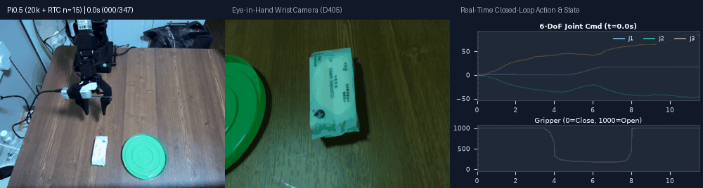
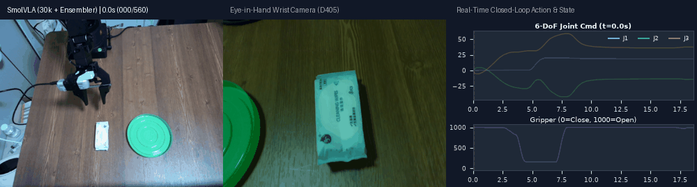
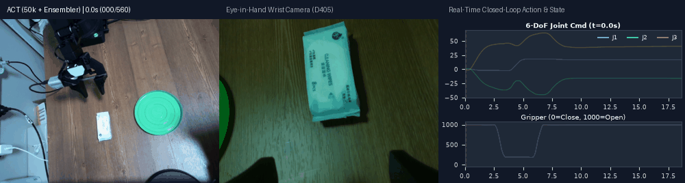
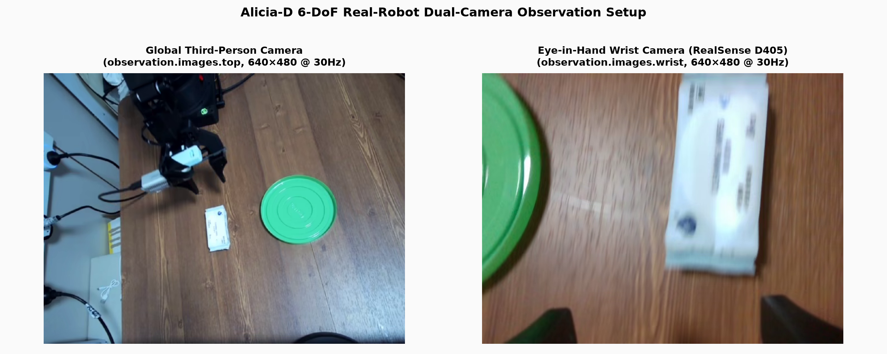
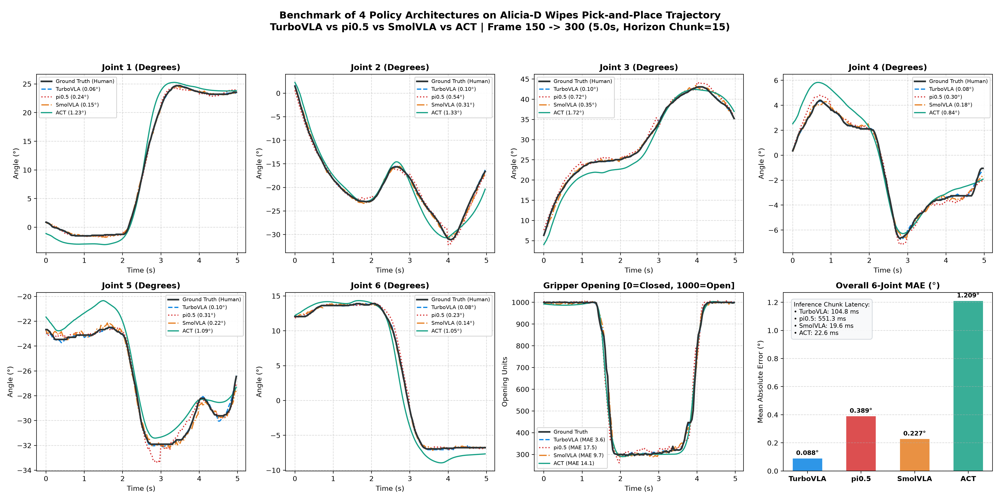
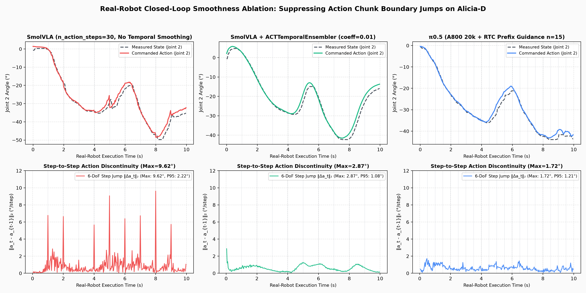
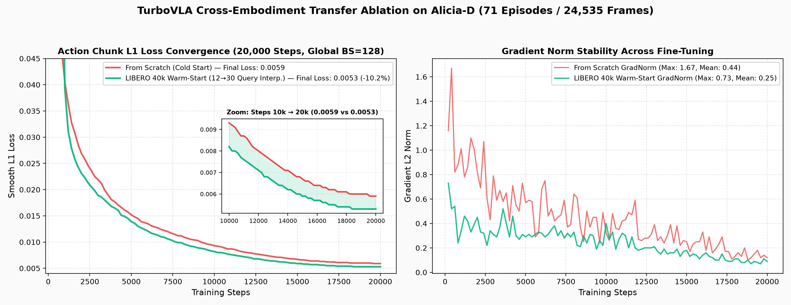

# Alicia-D Real-Robot VLA Benchmark: End-to-End Reproduction, Cross-Paradigm Comparison & Sim-to-Real Transfer

<p align="center">
  <b>ACT · SmolVLA · π<sub>0.5</sub> (Full / LoRA / RTC) · TurboVLA (0.2B Cross-Embodiment Warm-Start)</b><br>
  <i>Built on Synria Alicia-D 6-DoF Manipulator & HuggingFace LeRobot</i>
</p>

---

## 📖 项目概览 (Overview)

本仓库整理了基于 **Alicia-D 六轴机械臂（6-DoF + 平行夹爪）** 与 **LeRobot** 框架的具身视觉语言动作模型（VLA）全流程真机复现、跨范式横向对比与跨本体迁移工作。围绕桌面精细操作任务 **`Pick up the wipes and place them on the green plate`（抓取湿巾并放入绿盘，71 Episodes / 24,535 Frames @ 30Hz）**，我们打通了从**遥操作双视角示教采集、数据清洗转换、全量/LoRA 微调、跨本体热启动迁移，到真机时序平滑闭环部署**的完整链路，并对四种代表性具身动作生成范式进行了系统级对比：

| 模型 (Policy) | 动作生成范式 (Paradigm) | 参数量 | 视觉与语言骨干 (Backbone) | 6轴轨迹跟踪 MAE ↓ | 夹爪 MAE ↓ | 单块推理延迟 (Chunk Latency) ↓ |
| :--- | :--- | :---: | :--- | :---: | :---: | :---: |
| **TurboVLA (Warm-Start 20k)** | Bi-CrossAttn + ACT Decoder (L1) | **0.20 B** | DINOv3-ViT-B/16 + BERT-base | **0.088°** 🏆 | **3.63** 🏆 | 104.8 ms (9.5 chunks/s) |
| **SmolVLA (30k)** | Lightweight VLM + Flow Matching | **0.45 B** | SmolVLM2-500M-Video | 0.227° | 9.74 | **19.6 ms** ⚡ (51.0 chunks/s) |
| **$\pi_{0.5}$ (Full 20k)** | VLM + Action Expert Flow Matching | **4.14 B** | PaliGemma-3B + Gemma-300M | 0.389° | 17.45 | 551.3 ms (1.8 chunks/s) |
| **ACT (50k)** | CVAE Encoder + Transformer Decoder | **0.08 B** | ResNet-18 (ImageNet) | 1.209° | 14.12 | 22.6 ms (44.2 chunks/s) |

> 📌 **技术要点速查索引**：可直接查看 [`docs/technical_mapping.md`](docs/technical_mapping.md)，其中将各项具身技术方案精确映射到了本仓库的源码文件、函数行号与实验图表。

---

## 🎬 真机闭环实测演示 (Real-Robot Closed-Loop Rollouts)

以下动图均由本机真机闭环评测日志（`eval_runs/`，30Hz 实时采集）自动合成，依次展示 **全局顶视相机 (`observation.images.top`)**、**手腕第一视角相机 (`RealSense D405, observation.images.wrist`)** 以及 **右侧 6 轴关节角与夹爪开合度（0=闭合，1000=张开）的实时闭环跟踪曲线**：

### 1. $\pi_{0.5}$ (4.14B Full Fine-Tune 20k + RTC 实时分块引导 `n_action_steps=15`)


### 2. SmolVLA (0.45B 30k + `ACTTemporalEnsembler` 时序指数加权平滑)


### 3. ACT (50k + Temporal Ensemble `coeff=0.01`)


---

## 🛠️ 硬件平台与双视角观测配置 (Hardware & Dual-Camera Setup)



- **机械臂本体**：玄雅 Synria **Alicia-D** 6 自由度桌面机械臂 + 平行夹爪（控制频率 `30 Hz`，关节状态/指令在底层驱动 [`hardware/alicia_d_follower.py`](hardware/alicia_d_follower.py) 中完成弧度 $\leftrightarrow$ 角度双向转换与限幅保护）。
- **双视角视觉输入 (`640×480 @ 30Hz`)**：
  - `observation.images.top`：第三视角全局定焦相机，提供绿盘目标位置与机械臂全局空间构型；
  - `observation.images.wrist`：手腕 Eye-in-Hand **Intel RealSense D405** 近距相机，提供湿巾抓取瞬间的精细局部接触视野。
- **多策略视觉键名自适应对齐**：在 [`scripts/eval_alicia_arms.py`](scripts/eval_alicia_arms.py) 中实现了零拷贝 `camera_key_mapping`，自动将物理相机的 `top / wrist` 映射为各模型预训练期望的特征名（如 SmolVLA 的 `camera1 / camera2`、$\pi_{0.5}$ 的 `base_0_rgb / left_wrist_0_rgb`）。

---

## 📊 核心实验与消融分析 (Benchmarks & Ablation Studies)

### 实验一：四大具身策略 150 帧黄金抓取段轨迹跟踪横评
我们在真机示教数据集 Episode 0 的核心抓取-抬升-平移-释放窗口（`Frame 150 → 300`，共 150 帧 / 5.0 秒）上，以每 30 帧（1.0 秒）重规划一次的方式对 **TurboVLA、SmolVLA、$\pi_{0.5}$、ACT** 进行开环预测与真机 Ground Truth 轨迹对齐评测（复现脚本：[`scripts/eval_and_plot_trajectory.py`](scripts/eval_and_plot_trajectory.py)）：



**关键结论**：
1. **轨迹还原精度**：**TurboVLA (`0.088°`) < SmolVLA (`0.227°`) < $\pi_{0.5}$ (`0.389°`) < ACT (`1.209°`)**。基于 DINOv3 密集几何特征与双向 Cross-Attention 融合的 TurboVLA 在 6 个机械臂关节和夹爪开闭时机（`t=3.1s` 闭合抓取、`t=4.4s` 张开释放）上几乎与真机示教轨迹完全重合；
2. **Flow Matching vs 确定性回归**：SmolVLA 与 $\pi_{0.5}$ 采用条件流匹配（ODE 10 步去噪采样），在关节 2/3/5 的速度拐点处同样高度贴合，仅因高斯先验采样存在约 `0.2°~0.4°` 的平滑随机方差；
3. **推理延迟与算控权衡**：**SmolVLA (`19.6 ms`)** 与 **ACT (`22.6 ms`)** 单块耗时均低于 30Hz 单帧周期（`33.3 ms`），支持每步实时重规划；**TurboVLA (`104.8 ms`)** 在 chunk 执行期内仅占 **10.5%** 算力负载；而 4.14B 的 **$\pi_{0.5}$ (`551.3 ms`)** 必须配合 Action Chunking（`n_action_steps=15~30`）与 RTC 前缀引导以掩盖块间推理停顿。

---

### 实验二：真机机械臂抖动抑制 —— `ACTTemporalEnsembler` 时序平滑与 $\pi_{0.5}$ RTC 消融
在真机闭环测试中，单纯按固定步长（如 `n_action_steps=30`）弹出动作块会在块交界处产生明显的关节角速度阶跃与机械臂顿挫。为此我们在 [`scripts/eval_alicia_arms.py`](scripts/eval_alicia_arms.py) 中实现了两套平滑机制：
1. **SmolVLA 外挂 `ACTTemporalEnsembler`**：绕过 SmolVLA 原生队列缓存，每步调用 `_get_action_chunk()` 获取最新 30 步预测，并对同一时刻的历史重叠预测施加指数衰减加权 $w_i = \exp(-0.01 \cdot i)$；
2. **$\pi_{0.5}$ 实时分块引导（RTC Prefix Guidance）**：每执行 15 步触发重规划时，将上一块剩余未执行的 15 步作为 `prev_chunk_left_over` 注入 ODE 去噪流场，约束新旧动作块在交界处一阶连续。



---

### 实验三：TurboVLA 跨本体热启动迁移与 `action_queries` 线性插值消融
在将单卡 RTX 4090 上预训练好的 **LIBERO 40 任务权重（平均成功率 95.6%，`chunk_size=12`）** 迁移至 **Alicia-D 真机高频控制（`chunk_size=30`）** 时，针对解码器动作查询向量维度不一致问题，我们在 [`policies/turbovla_alicia/train_wipes.py`](policies/turbovla_alicia/train_wipes.py#L128-L148) 中实现了沿时间维度的 **线性插值对齐（`[12, 256] → [30, 256]`）**，并在 24,535 帧真机数据上完成了 **20,000 Steps（Global Batch Size = 128）从头训练 vs LIBERO 热启动** 严格对照消融：



| 训练策略 (Training Mode) | `action_queries` 初始化 | 8维状态编码器适配 | 峰值梯度范数 (Max GradNorm) ↓ | 最终收敛 Loss (20k Steps) ↓ | Frame 100 真机开环 MAE ↓ |
| :--- | :--- | :--- | :---: | :---: | :---: |
| **Exp B: From Scratch (Cold Start)** | 随机正态初始化 `[30, 256]` | 随机初始化 | 1.67 | 0.0059 | 0.087° |
| **Exp A: LIBERO 40k Warm-Start** | **线性插值 `[12, 256] → [30, 256]`** | **7维补零对齐 8维无损复用** | **0.73 (-56.3%)** | **0.0053 (-10.2%)** 🏆 | **0.080°** 🏆 |

---

## 🗂️ 仓库目录结构 (Repository Structure)

```text
alicia-d-vla-benchmark/
├── README.md                                  # 项目主页：真机闭环动图、跨范式定量对比与消融实验分析
├── docs/
│   ├── technical_mapping.md                   # 技术方案与代码文件/行号/实验证据对应索引
│   ├── train_wipes_a_warmstart.log            # TurboVLA LIBERO 40k 热启动微调 20,000 steps 完整日志
│   └── train_wipes_b_scratch.log              # TurboVLA 从头训练 20,000 steps 完整对照日志
├── assets/
│   ├── demos/                                 # 真机闭环三联同屏 GIF (π0.5 RTC / SmolVLA Ensemble / ACT)
│   ├── benchmarks/                            # 四模型轨迹跟踪对比图、时序平滑消融图、热启动 Loss/GradNorm 曲线
│   └── hardware/                              # Alicia-D 双相机（Top + Wrist D405）视野实拍与概览图
├── hardware/
│   ├── alicia_d_follower.py                   # Alicia-D 6轴+夹爪 LeRobot Follower 硬件通信层
│   ├── config_alicia_d_follower.py            # 串口、双摄分辨率及安全限幅配置类
│   └── __init__.py
├── policies/
│   ├── lerobot_adapters/                      # ACT / SmolVLA / π0.5 训练配方与适配组件
│   │   ├── train_pi05_a800_full.sh            # π0.5 (4.14B) A800 30k 全参数微调生产启动脚本
│   │   ├── train_pi05_4090_lora.sh            # π0.5 (4.14B) RTX 4090 单卡 PEFT LoRA 微调脚本
│   │   ├── train_smolvla_4090.sh              # SmolVLA (0.45B) RTX 4090 30k (batch_size=64) 训练脚本
│   │   ├── train_act_4090.sh                  # ACT (80M) RTX 4090 50k (chunk=100) 从头训练脚本
│   │   ├── merge_pi05_lora.py                 # π0.5 LoRA 权重合并与归一化处理器打包工具
│   │   ├── temporal_ensembler.py              # ACTTemporalEnsembler 独立时序指数加权平滑器
│   │   ├── rtc_processor.py                   # π0.5 实时分块 (RTC) 前缀引导处理器
│   │   ├── camera_mapper.py                   # 跨模型视觉观测键名自适应映射模块
│   │   └── configs/                           # 各模型训练参数配置 (JSON)
│   └── turbovla_alicia/
│       ├── train_wipes.py                     # 支持 action_queries [12->30] 线性插值热启动的微调脚本
│       ├── wipes_dataset.py                   # Alicia-D 双摄 MP4 + Parquet 数据集加载与 8 维状态补零对齐
│       ├── wipes_stats.json                   # 24,535 帧真机数据集归一化统计量 (Mean/Std/Min/Max)
│       └── dinov3_compat.py                   # 无 timm 依赖的独立 DINOv3-ViT 旋转位置编码兼容层
└── scripts/
    ├── eval_alicia_arms.py                    # ACT / SmolVLA / π0 / π0.5 统一真机闭环推理脚本 (含 Temporal Ensemble & RTC)
    ├── eval_alicia_turbovla.py                # TurboVLA 真机闭环推理与单帧开环精度校验脚本
    ├── eval_and_plot_trajectory.py            # 四大模型 150 帧黄金抓取段轨迹跟踪评测与可视化脚本
    ├── train_turbovla_wipes_b_then_a.sh       # TurboVLA 从头训练 vs LIBERO 热启动自动化消融流水线
    └── generate_repo_visuals.py               # 从真机 eval_runs 自动合成 GIF 动图与消融图表的工具脚本
```

---

## 🚀 快速开始 (Quick Start)

### 1. 真机闭环推理：ACT / SmolVLA / $\pi_{0.5}$
```bash
# 示例 1：运行 SmolVLA (30k) 并开启 ACTTemporalEnsembler 时序加权平滑
python scripts/eval_alicia_arms.py \
  --policy.path=weights/smolvla_wipes_30k \
  --robot.port=/dev/ttyACM0 \
  --temporal_ensemble_coeff=0.01 \
  --task="Pick up the wipes and place them on the green plate."

# 示例 2：运行 π0.5 (A800 20k) 并开启 RTC 实时分块前缀引导 (n_action_steps=15)
python scripts/eval_alicia_arms.py \
  --policy.path=weights/pi05_wipes_a800_20k \
  --robot.port=/dev/ttyACM0 \
  --rtc_enabled=true \
  --n_action_steps=15 \
  --task="Pick up the wipes and place them on the green plate."
```

### 2. 真机闭环推理与离线校验：TurboVLA (0.2B)
```bash
# 先在真机数据帧上做单帧开环校验与延迟测试 (--test_only)
python scripts/eval_alicia_turbovla.py \
  --checkpoint weights/turbovla_wipes/turbovla_wipes_warmstart_step_20000.pth \
  --stats_path policies/turbovla_alicia/wipes_stats.json \
  --test_only --test_frame 100

# 连接 Alicia-D 机械臂启动 30Hz 真机闭环控制（带指数平滑 --temporal_ensemble_coeff 0.01）
python scripts/eval_alicia_turbovla.py \
  --checkpoint weights/turbovla_wipes/turbovla_wipes_warmstart_step_20000.pth \
  --stats_path policies/turbovla_alicia/wipes_stats.json \
  --port /dev/ttyACM0 \
  --n_action_steps 15 \
  --temporal_ensemble_coeff 0.01
```

### 3. 一键复现四大模型轨迹对比曲线与真机 GIF
```bash
# 运行四大模型 150 帧黄金抓取段开环轨迹跟踪评测
python scripts/eval_and_plot_trajectory.py

# 重新生成仓库所有消融曲线与真机三联同屏 GIF
python scripts/generate_repo_visuals.py
```
