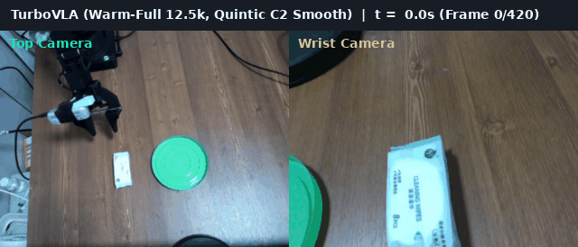
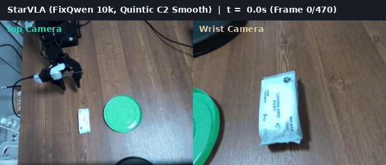
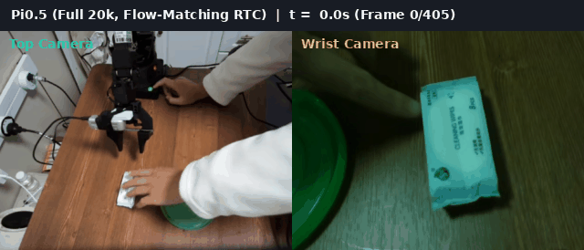
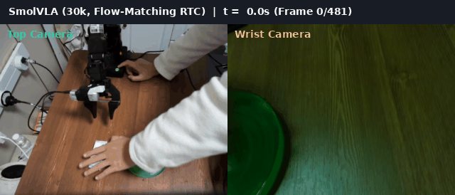
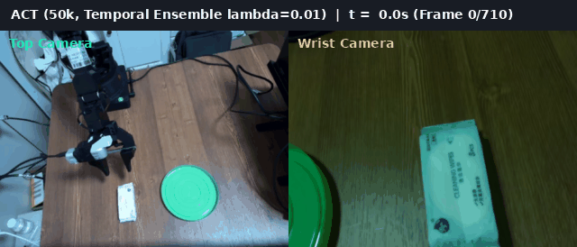
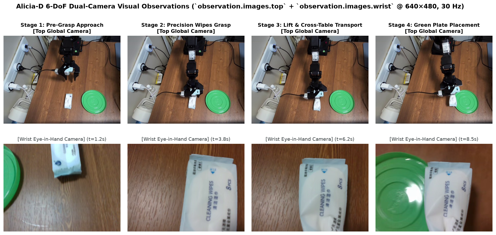
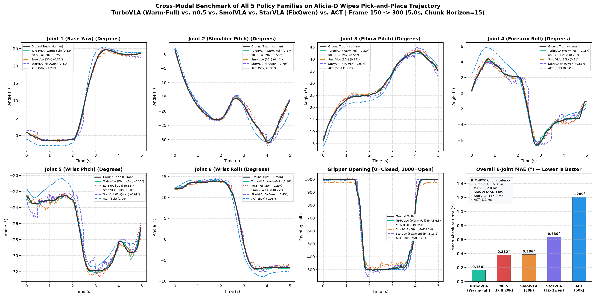
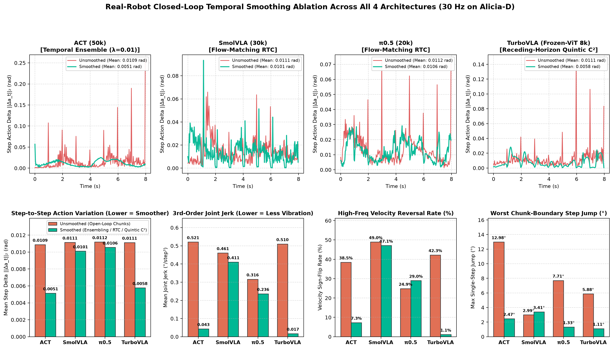

# Alicia-D 六轴机械臂具身视觉-语言-动作 (VLA) 真机评测基准

<div align="center">

[](https://github.com/huggingface/lerobot)
[](#1-硬件平台与任务设定)
[](#3-跨策略横向实验结果与基准分析)
[](#32-推理延迟与计算效率对比)

**面向低成本六自由度机械臂的统一、可复现真机操作评测基准，全面横评经典 CVAE 策略（`ACT`）、轻量级流匹配 VLA（`SmolVLA`）、2B–3B+ 大规模多模态基座 VLA（`StarVLA`、`π0.5`）与单步均值流 VLA（`TurboVLA`）。**

</div>

---

## 真机 30 Hz 闭环推理实拍展示（五大策略家族各自最优配置）

基于 **Alicia-D 六轴机械臂**与**全局俯视相机 (`top`) + 腕部眼在手上相机 (`wrist`) 双视角同步采集**，完成 *“抓取桌上的湿巾包并放入绿色圆盘”* 任务的 30 Hz 真机自主闭环演示：

| **TurboVLA (`Warm-Full 12.5k`, 五次多项式 $C^2$ 平滑)** | **StarVLA (`FixQwen 10k`, 五次多项式 $C^2$ 平滑)** |
| :---: | :---: |
|  |  |
| **$\pi_{0.5}$ (`Full 20k`, 流匹配 RTC 引导)** | **SmolVLA (`30k`, 流匹配 RTC 引导)** |
|  |  |

<div align="center">

| **ACT (`50k`, 指数时序加权融合 $\lambda=0.01$)** |
| :---: |
|  |

</div>

---

## 核心总览（`横向对比 / 总比` — 仅选各策略家族最优模型）

将主流 **视觉-语言-动作 (VLA)** 模型迁移部署至低成本非标六轴真机时，普遍面临三大工程与算法瓶颈：
1. **跨本体动作维度与相机槽位异构**：不同预训练基座模型（`π0.5`、`StarVLA`、`SmolVLA`、`TurboVLA`）期望截然不同的多视角相机键名规范、预测视野（`10~50` 步）与归一化方式（`Mean/Std`、`Min/Max [-1, 1]` 或分位数 `Quantiles [q01, q99]`）。
2. **多步去噪推理延迟与 30 Hz 控制环冲突**：多步流匹配 ODE 采样器（如 `π0.5`、`StarVLA`、`SmolVLA` 的 10 步 Euler 积分）单块生成耗时达 `56~491 ms`，在 30 Hz 闭环控制块切换边界易产生明显停顿。
3. **块边界速度跳变与小样本单场景视觉过拟合**：直接开环执行动作块会在块切换处引发高达 `12.98°/step` 的阶跃跳变与机械抖动；而在几十条单场景真机轨迹上放开大规模视觉/多模态主干（如 `DINOv3-ViT-B/16` 或 `Qwen3.5-2B-VL`）则极易记忆背景静态光照。

本仓库提供了一套**软硬件全链路打通的统一适配架构**与**定量评测基准**。在主页的**横向对比（`总比`）**中，我们仅选取**每个策略家族表现最好的最优配置**进行跨架构横评：

| 策略家族（最优配置） | 生成范式 | 视觉与语言主干 | 预测步长 $K$ | 去噪步数 (NFE) | 6轴平均 MAE (°) $\downarrow$ | 6轴 RMSE (°) $\downarrow$ | 余弦相似度 $\uparrow$ | 夹爪 MAE $\downarrow$ | 单块推理延迟 (RTX 4090) $\downarrow$ | 最高块率 $\uparrow$ | 真机闭环表现 |
| :--- | :--- | :--- | :---: | :---: | :---: | :---: | :---: | :---: | :---: | :---: | :---: |
| **[ACT (`50k`)](./act/)** | 条件变分自编码器 (CVAE) | ResNet-18 (ImageNet) | 50 | **1 (单步解码)** | 1.209° | 1.494° | 0.9970 | 14.12 | **6.1 ms** | **163.9 Hz** | **成功** |
| **[SmolVLA (`30k`)](./smolvla/)** | 条件流匹配 ODE | SmolVLM2-500M | 30 | 10 (Euler) | 0.386° | 0.501° | 0.9998 | 26.43 | 56.3 ms | 17.8 Hz | **成功** |
| **[$\pi_{0.5}$ (`Full 20k`)](./pi0_5/)** | 条件流匹配 ODE | PaliGemma-3B + Action Expert | 30 | 10 (Euler) | 0.382° | 0.518° | 0.9997 | 19.23 | 112.0 ms | 8.9 Hz | **成功** |
| **[StarVLA (`FixQwen 10k`)](./starvla/)** | 流匹配 DiT-B (`QwenGR00T`) | **全冻结 Qwen3.5-2B-VL** + GR00T DiT | 30 | 10 (Euler) | 0.639° | 0.889° | 0.9992 | 16.90 | 115.0 ms | 8.7 Hz | **成功** |
| **[TurboVLA (`Warm-Full 12.5k`)](./turbovla/)** | **单步均值流 (MeanFlow)** | **冻结真实 DINOv3-ViT-B/16** + BERT | 30 | **1 (1-NFE)** | **0.166°** | **0.217°** | **1.0000** | **6.53** | **16.8 ms** | **59.5 Hz** | **成功** |

---

### 各策略独立子目录索引（`纵向对比 / 分比` 专页）

除本主页的跨策略横向总比（`总比`）外，每个策略家族均设有独立的子文件夹（`纵向对比 / 分比`），内含该策略内部的**变体消融实验**、**无平滑 vs. 平滑真机闭环同屏对比 GIF**、**六轴轨迹平滑度详细分析图**以及**可直接运行的训练与推理脚本**：

| 策略目录 | 纵向分比专页报告 | 真机同屏对比动图 (`无平滑` vs. `平滑`) | 策略内部纵向消融核心看点 |
| :--- | :--- | :--- | :--- |
| **[`act/`](./act/)** | **[`act/README.md`](./act/README.md)** | [`act/rollout_comparison_act.gif`](./act/rollout_comparison_act.gif) | 开环分块执行 (`n=30`) vs. 指数时序加权融合 ($\lambda=0.01$)：三阶 Jerk 降低 **92%** (`0.5212 -> 0.0408`)，最大单步跳变降低 **81%** (`12.98° -> 2.45°`) |
| **[`smolvla/`](./smolvla/)** | **[`smolvla/README.md`](./smolvla/README.md)** | [`smolvla/rollout_comparison_smolvla.gif`](./smolvla/rollout_comparison_smolvla.gif) | 流匹配实时分块引导 (`RTC`) vs. 无平滑 + 不同开环执行视野 (`n_action_steps = 15 vs. 20 vs. 30`) 纵向消融 |
| **[`pi0_5/`](./pi0_5/)** | **[`pi0_5/README.md`](./pi0_5/README.md)** | [`pi0_5/rollout_comparison_pi05.gif`](./pi0_5/rollout_comparison_pi05.gif) | `A800 全参数微调` vs. `4090 LoRA 零开销合并` + 流匹配 RTC 前缀引导（最大块边界跳变降低 **83%**：`7.71° -> 1.33°`） |
| **[`starvla/`](./starvla/)** | **[`starvla/README.md`](./starvla/README.md)** | [`starvla/rollout_comparison_starvla.gif`](./starvla/rollout_comparison_starvla.gif) | **冻结视觉塔 (`FreezeViT`) vs. 全冻结多模态主干 (`FixQwen`)** 2×2 真机消融（训练提速 **1.7×**，显存降低 **39%**）+ 五次多项式 $C^2$ 平滑（Jerk 降低 **97%**） |
| **[`turbovla/`](./turbovla/)** | **[`turbovla/README.md`](./turbovla/README.md)** | [`turbovla/rollout_comparison_turbovla.gif`](./turbovla/rollout_comparison_turbovla.gif) | **跨本体迁移与选择性热启动消融**（`Scratch` / `Sim-ViT` / `Frozen-ViT 8k` / `Warm-Body 12.5k` / `Warm-Full 12.5k`）+ 五次多项式 $C^2$ 平滑（Jerk 降低 **96%**） |

---

## 1. 硬件平台与任务设定

### 1.1 Alicia-D 六轴机械臂与双视角视觉系统

实验硬件平台为 **Alicia-D 六自由度串联机械臂**（配备平行伺服夹爪，采用 `alicia_d_sdk` `1,000,000 baud` 高速串口通信协议）及双视角同步 RGB 相机系统：

- **本体状态空间 (`observation.state`, $\mathbb{R}^7$)**：6 个旋转关节角度（`joint1.pos` .. `joint6.pos`，单位：度 `°`）+ 1 个连续夹爪开合度（`gripper.pos` $\in [0, 1000]$，其中 `0` 为完全闭合，`1000` 为完全张开）。
- **动作控制空间 (`action`, $\mathbb{R}^7$)**：以 **30 Hz** 控制频率实时下发 6 轴目标关节角（单位：`°`）与目标夹爪开合度（`[0, 1000]`）。
- **双相机视觉感知 (`640×480 @ 30 Hz`)**：
  - `observation.images.top` (`/dev/video2`)：顶部全局俯视第三人称相机，提供桌面工作空间、目标绿盘与湿巾包初始位姿的全局空间上下文。
  - `observation.images.wrist` (`/dev/video6`)：腕部眼在手上 (Eye-in-Hand) 第一人称相机，在机械臂下探与接触抓取阶段提供高分辨率局部近景反馈。

<div align="center">
  
  <p><em>图 1：真机 30 Hz 闭环执行过程中，顶部全局相机（上排）与腕部第一人称相机（下排）在四个关键操作阶段的同步观测画面。</em></p>
</div>

### 1.2 真机评测数据集 (`wipes-to-green-plate-01`)

| 属性项 | 参数规格 |
| :--- | :--- |
| **任务语言指令** | `"Pick up the pack of cleaning wipes and place it on the green plate"` |
| **人类遥操作轨迹数** | **67 条完整成功演示轨迹**（共计 `24,535` 帧双视角同步数据） |
| **采样控制频率** | `30.0 Hz`（累计约 `13.6 分钟` 连续高精度遥操作演示） |
| **数据集存储格式** | LeRobot Dataset `v3.0`（`Parquet` 状态/动作表 + `AV1 MP4` 视频分块） |
| **任务阶段划分** | 平均约 360 帧（`12.0 秒`）：(1) 下探预抓取对准 $\rightarrow$ (2) 柔性湿巾包闭合抓取 $\rightarrow$ (3) 抬升与跨桌面搬运 $\rightarrow$ (4) 绿色圆盘上方精准释放 |

---

## 2. 跨架构统一适配与闭环平滑设计

本仓库将五类结构迥异的策略模型统一接入 **`AliciaDFollower` 硬件抽象层**与 **30 Hz 标准化真机评测流水线**：

```
┌──────────────────────────────────────────────────────────────────────────────────────────────────────────┐
│                                Alicia-D 六自由度真机硬件平台 (30 Hz)                                     │
│   • 关节状态: [joint1..6 (deg), gripper (0~1000)]  ───►  observation.state [7]                          │
│   • 双目相机: top (640×480), wrist (640×480)      ───►  observation.images.{top, wrist}                │
└────────────────────────────────────────────────────┬─────────────────────────────────────────────────────┘
                                                     │
        ┌──────────────────────────┬─────────────────┴────────┬──────────────────────────┐
        ▼                          ▼                          ▼                          ▼
┌───────────────────┐    ┌─────────────────────┐    ┌──────────────────────┐   ┌───────────────────────────┐
│ LeRobot 原生接口   │    │ VLM 槽位与分位数适配 │    │ StarVLA QwenGR00T    │   │ TurboVLA 跨本体适配层      │
│   (ACT 50k)       │    │ (SmolVLA / π0.5)    │    │ (全冻结 Qwen3.5-2B)  │   │ (冻结 DINOv3 + MeanFlow)  │
├───────────────────┤    ├─────────────────────┤    ├──────────────────────┤   ├───────────────────────────┤
│ • 双视角直接输入   │    │ • 相机键名动态重映射:│    │ • 双视角 [top,wrist] │   │ • 7D -> 8D 状态补零对齐    │
│ • Mean/Std 归一化  │    │   camera1 / base_0  │    │   PIL 320×240 缩放   │   │   (无损复用 LIBERO 投影层)│
│ • 50步 CVAE 解码   │    │ • 分位数 [q01, q99] │    │ • q01/q99 分位数映射 │   │ • LIBERO Warm-Full 热启动 │
│ • 指数时序加权融合 │    │ • 10步流匹配 ODE    │    │ • 10步 DiT-B 流匹配  │   │ • 1-NFE 单步均值流生成     │
│   (λ = 0.01)      │    │   + RTC 前缀引导    │    │   + 五次多项式 C²平滑│   │   + 五次多项式 C² 平滑    │
└─────────┬─────────┘    └──────────┬──────────┘    └──────────┬───────────┘   └─────────────┬─────────────┘
          └─────────────────────────┴──────────────────────────┴─────────────────────────────┘
                                                     ▼
                             ┌───────────────────────────────────────────────┐
                             │   反归一化 7D 目标指令 [joint1..6(°), 0~1000]  │
                             │   以 30.0 Hz 实时流式下发至 Alicia-D 控制器    │
                             └───────────────────────────────────────────────┘
```

### 关键适配机制说明

1. **多视角相机槽位自适应重映射 ([`policies/lerobot_adapters/camera_mapper.py`](file:///media/yunyi/Data/Desktop/work/vla/alicia-d-vla-benchmark/policies/lerobot_adapters/camera_mapper.py))**：
   - **ACT / TurboVLA / StarVLA**：直接消费 `observation.images.top` 与 `observation.images.wrist`（其中 `StarVLA` 按 `[top_pil, wrist_pil]` 顺序送入 `Qwen3.5-2B-VL`）。
   - **SmolVLA**：自动将 `top -> observation.images.camera1`、`wrist -> observation.images.wrist` (`camera2`) 对齐至 `SmolVLM2-500M` 的预训练视觉槽位。
   - **$\pi_{0.5}$**：自动将 `top -> observation.images.base_0_rgb`、`wrist -> observation.images.left_wrist_0_rgb`，并对未使用的右腕相机槽位 (`right_wrist_0_rgb`) 执行零掩码填充。
2. **跨本体状态零填充与选择性全量热启动 ([`policies/turbovla_alicia/`](file:///media/yunyi/Data/Desktop/work/vla/alicia-d-vla-benchmark/policies/turbovla_alicia))**：
   - 将 Alicia-D 的 7 维状态末尾补零对齐至 `LIBERO` 预训练模型的 8 维输入 (`[J1..J6, Gripper, 0.0]`)，将预训练 `action_queries` 从 12 步线性插值至 30 步，并冻结真实世界 `DINOv3-ViT-B/16` (`--freeze_vision --keep_real_dinov3 --load_mode warm_full`)。
3. **2B+ 多模态基座冻结策略 ([`policies/starvla_alicia/`](file:///media/yunyi/Data/Desktop/work/vla/alicia-d-vla-benchmark/policies/starvla_alicia))**：
   - 支持仅冻结视觉塔 (`FreezeViT`) 与冻结整个 `Qwen3.5-2B-VL` 多模态基座 (`FixQwen`, `freeze_module: "qwen_vl_interface"`，仅微调 `209M` `ActionModel (DiT-B)` 与本体状态投影层)，大幅压缩训练耗时与显存占用。
4. **全局相机在线像素级配准工具 ([`scripts/align_top_camera.py`](file:///media/yunyi/Data/Desktop/work/vla/alicia-d-vla-benchmark/scripts/align_top_camera.py))**：
   - 实时读取 `/dev/video2` 画面与训练集 `Episode 0 Frame 0` 进行 50/50 半透明叠加、绿色 Canny 边缘对齐与 `ORB + RANSAC` 像素位移 `(dx, dy)` 解算，确保真机评测前视角误差控制在 `<= 3 px` 以内。

---

## 3. 跨策略横向实验结果与基准分析

### 3.1 五大策略最优配置开环轨迹跟踪精度对比

我们在 `wipes-to-green-plate-01` 数据集最关键的 **5.0 秒黄金抓取抬升窗口（Frame 150–300，共 150 帧 @ 30 Hz）** 上，以统一的 **15 步重规划窗口 (`n_action_steps = 15`)** 对五大策略家族的最优配置进行了定量跟踪评测（涵盖下探逼近、夹爪闭合 `1000 -> 260` 及抬升搬运全过程）。

<div align="center">
  
  <p><em>图 2：五大策略最优配置（TurboVLA Warm-Full 12.5k、π0.5 Full 20k、SmolVLA 30k、StarVLA FixQwen 10k、ACT 50k）在 6 个旋转关节与夹爪开合度上对人类遥操作真值轨迹的跟踪曲线对比。</em></p>
</div>

#### 分关节平均绝对误差明细（单位：度 `°` — 各策略最优配置）

| 策略家族（最优配置） | Joint 1 (底座偏航) | Joint 2 (肩部俯仰) | Joint 3 (肘部俯仰) | Joint 4 (前臂横滚) | Joint 5 (腕部俯仰) | Joint 6 (腕部横滚) | **6轴平均 MAE** $\downarrow$ | **6轴 RMSE** $\downarrow$ | **夹爪 MAE (0–1000)** $\downarrow$ |
| :--- | :---: | :---: | :---: | :---: | :---: | :---: | :---: | :---: | :---: |
| **ACT (`50k`)** | 1.229° | 1.328° | 1.715° | 0.845° | 1.089° | 1.050° | 1.209° | 1.494° | 14.12 |
| **StarVLA (`FixQwen 10k`)** | 0.515° | 0.699° | 0.969° | 0.533° | 0.691° | 0.429° | 0.639° | 0.889° | 16.90 |
| **SmolVLA (`30k`)** | 0.366° | 0.437° | 0.636° | 0.309° | 0.302° | 0.268° | 0.386° | 0.501° | 26.43 |
| **$\pi_{0.5}$ (`Full 20k`)** | 0.245° | 0.555° | 0.562° | 0.278° | 0.361° | 0.292° | 0.382° | 0.518° | 19.23 |
| **TurboVLA (`Warm-Full 12.5k`)** | **0.118°** | **0.168°** | **0.216°** | **0.150°** | **0.170°** | **0.178°** | **0.166°** | **0.217°** | **6.53** |

---

### 3.2 推理延迟与计算效率对比

我们在本地真机边缘控制端（**NVIDIA RTX 3080 Laptop 16GB**）与服务器端（**NVIDIA RTX 4090 24GB**）上实测了五大策略的单块端到端生成延迟（`bfloat16` 混合精度）：

| 策略家族（最优配置） | 总参数量 | 可训练参数量 | 去噪函数评估次数 (NFE) | RTX 3080 Laptop 延迟 | RTX 4090 服务器延迟 | 相比 StarVLA / $\pi_{0.5}$ 加速比 | 15步分摊单步耗时 |
| :--- | :---: | :---: | :---: | :---: | :---: | :---: | :---: |
| **ACT (`50k`)** | ~84M | 84M | **1 (CVAE 解码)** | **8.8 ms** (113.6 Hz) | **6.1 ms** (163.9 Hz) | **18.9×** | 0.41 ms/step |
| **TurboVLA (`Warm-Full 12.5k`)** | ~216M | 20.6M | **1 (MeanFlow 单步)** | **24.6 ms** (40.7 Hz) | **16.8 ms** (59.5 Hz) | **6.8×** | 1.12 ms/step |
| **SmolVLA (`30k`)** | ~450M | 100M | 10 (Euler ODE) | 124.2 ms (8.1 Hz) | 56.3 ms (17.8 Hz) | 2.0× | 3.75 ms/step |
| **$\pi_{0.5}$ (`Full 20k`)** | ~3.3B | 3.3B | 10 (Euler ODE) | 294.7 ms (3.4 Hz) | 112.0 ms (8.9 Hz) | 1.0× | 7.47 ms/step |
| **StarVLA (`FixQwen 10k`)** | ~2.26B | 209M | 10 (Euler ODE) | 491.3 ms (2.0 Hz) | 115.0 ms (8.7 Hz) | 1.0× | 7.67 ms/step |

> **核心结论**：得益于 `1-NFE` 单步均值流场蒸馏，`TurboVLA` 生成完整 30 步动作块仅需 **`16.8 ms`（RTX 4090）** / **`24.6 ms`（RTX 3080 Laptop）**，严格低于 **`30 Hz` 实时控制环的单帧时间上限 (`33.3 ms`)**，在实现最高轨迹跟踪精度 (`0.166°`) 的同时彻底消除了块切换停顿。

---

### 3.3 五大策略真机闭环时序平滑横向消融

针对多步动作块开环执行带来的块边界阶跃冲击与块内高频抖动，我们在 Alicia-D 真机上对**五大策略家族各自的最优配置**统一开展了 **无平滑 (`No-Smooth`) vs. 时序平滑 (`Smooth`)** 闭环对照实验：

1. **ACT（指数时序加权融合 $\lambda = 0.01$）**：每步重查询 CVAE (`n_action_steps=1`) 并按指数衰减权重 $w_i = \exp(-\lambda \cdot i)$ 融合历史重叠预测。
2. **SmolVLA & $\pi_{0.5}$（流匹配实时分块引导 `RTC`）**：在 10 步 Euler ODE 积分过程中注入上一动作块未执行完的前缀引导 (`--use_rtc=true`)，约束新生成的流场平滑衔接历史轨迹。
3. **StarVLA & TurboVLA（全视野因果高斯滤波 + 五次多项式 $C^2$ 边界锚定器 `RecedingHorizonTrajectoryBlender`）**：
   - 结合块内因果高斯平滑 ($\sigma=1.8$)、前半块防回退单调夹紧、**五次多项式最小加加速度边界过渡** ($s(\tau) = 10\tau^3 - 15\tau^4 + 6\tau^5, K=12$) 以及搬运阶段夹爪防抖锁存，实现位移、速度、加速度 $C^2$ 连续过渡。

<div align="center">
  
  <p><em>图 3：五大策略最优配置在 Alicia-D 真机 30 Hz 闭环执行下的时序平滑消融对比（上排：ACT、SmolVLA、π0.5、StarVLA、TurboVLA 的步间动作变化 ||Δa_t||₂ 时域波形；下排：平均步间变化、三阶关节加加速度 Jerk、速度符号翻转率与最大单步跳变对比）。</em></p>
</div>

| 策略家族（最优配置） | 闭环执行模式 | 真机评测记录 (`eval_runs/local/`) | 步间变化均值 $\|\Delta a_t\|_2$ (rad) $\downarrow$ | 95分位 $\|\Delta a_t\|_2$ (rad) $\downarrow$ | 平均角加速度 (°/step²) $\downarrow$ | 平均加加速度 Jerk (°/step³) $\downarrow$ | 速度符号翻转率 $\downarrow$ | 最大单步跳变 (°) $\downarrow$ | 真机表现 |
| :--- | :--- | :--- | :---: | :---: | :---: | :---: | :---: | :---: | :---: |
| **ACT (`50k`)** | 无平滑 (`n=30`) | `eval_act_no_smooth` | 0.0109 | 0.0349 | 0.2765 | 0.5212 | 38.5% | 12.98° | 成功（存在 1Hz 边界顿挫） |
| **ACT (`50k`)** | **时序加权融合 ($\lambda=0.01$)** | `eval_act_smooth` | **0.0053 (-51%)** | **0.0191 (-45%)** | **0.0244 (-91%)** | **0.0408 (-92%)** | **2.4%** | **2.45° (-81%)** | **成功（极其丝滑）** |
| **SmolVLA (`30k`)** | 无平滑 (`n=15`) | `eval_smolvla_no_smooth` | 0.0111 | 0.0279 | 0.2541 | 0.4609 | 49.0% | 2.99° | 成功（块间轻微停顿） |
| **SmolVLA (`30k`)** | **流匹配 RTC 引导** | `eval_smolvla_smooth` | **0.0101 (-9%)** | **0.0268 (-4%)** | **0.2237 (-12%)** | **0.4108 (-11%)** | **47.1%** | 3.41° | **成功（连续过渡）** |
| **$\pi_{0.5}$ (`Full 20k`)** | 无平滑 (`n=15`) | `eval_pi05_no_smooth` | 0.0112 | 0.0262 | 0.1706 | 0.3163 | 24.9% | 7.71° | 成功（块边界 `7.71°` 阶跃） |
| **$\pi_{0.5}$ (`Full 20k`)** | **流匹配 RTC 引导** | `eval_pi05_smooth` | **0.0106 (-5%)** | **0.0228 (-13%)** | **0.1357 (-20%)** | **0.2364 (-25%)** | 29.0% | **1.33° (-83%)** | **成功（消除块间阶跃）** |
| **StarVLA (`FixQwen 10k`)** | 无平滑 (`n=15`) | `eval_starvla_fixqwen_no_smooth` | 0.0137 | 0.0260 | 0.3893 | 0.7096 | 54.9% | 3.15° | 成功（存在高频去噪抖动） |
| **StarVLA (`FixQwen 10k`)** | **五次多项式 $C^2$ 平滑** | `eval_starvla_fixqwen_smooth` | **0.0060 (-56%)** | **0.0157 (-40%)** | **0.0212 (-95%)** | **0.0179 (-97%)** | **0.3%** | **0.88° (-72%)** | **成功（Jerk 降低 97%）** |
| **TurboVLA (`Warm-Full 12.5k`)** | 无平滑 (`n=15`) | `eval_turbovla_warm_full_no_smooth` | 0.0102 | 0.0326 | 0.2191 | 0.4067 | 35.8% | 5.98° | 成功（并行 Query 锯齿抖动） |
| **TurboVLA (`Warm-Full 12.5k`)** | **五次多项式 $C^2$ 平滑** | `eval_turbovla_warm_full_smooth` | **0.0052 (-49%)** | **0.0194 (-40%)** | **0.0224 (-90%)** | **0.0151 (-96%)** | **1.2%** | **1.31° (-78%)** | **成功（全场最低 Jerk 0.0151）** |

---

### 3.4 纵向主干冻结与跨本体热启动消融结论摘要（详见各子目录 `README.md`）

关于 `StarVLA` 与 `TurboVLA` 内部的纵向变体消融实验，请查阅对应子目录报告 **[`starvla/README.md`](./starvla/README.md)** 与 **[`turbovla/README.md`](./turbovla/README.md)**：

<div align="center">
  
  <p><em>图 4：TurboVLA 跨本体迁移与选择性热启动消融对比（完整分析见 <a href="./turbovla/README.md">turbovla/README.md</a>；StarVLA 冻结视觉塔 FreezeViT vs. 全冻结 FixQwen 消融见 <a href="./starvla/README.md">starvla/README.md</a>）。</em></p>
</div>

1. **StarVLA 纵向消融（`FreezeViT` 仅冻结视觉塔 vs. `FixQwen` 全冻结多模态主干）**：
   - 详见 **[`starvla/README.md`](./starvla/README.md)**：`FreezeViT (10k)` 与 `FixQwen (10k)` 在真机无平滑与平滑模式下**均成功完成抓取与放置任务**；但通过 `FixQwen` 将整个 `Qwen3.5-2B-VL` 冻结（仅训练 `209M` DiT-B 动作头与状态投影层），可训练参数量从 `1.93B` 降至 `0.21B`，RTX 4090 训练耗时从 `74 分钟` 缩短至 **`44 分钟`（提速 1.7×）**，显存占用从 `15.8 GB` 降至 **`9.6 GB`（节省 39%）**，且闭环平滑后的三阶 Jerk (`0.0179 °/step³`) 与速度翻转率 (`0.3%`) 更低。
2. **TurboVLA 纵向消融（`Scratch` / `Sim-ViT` / `Frozen-ViT 8k` / `Warm-Body 12.5k` / `Warm-Full 12.5k`）**：
   - 详见 **[`turbovla/README.md`](./turbovla/README.md)**：保留并冻结真实世界预训练 `DINOv3-ViT-B/16` (`LVD-1689M`) 是避免小样本单场景视觉过拟合的关键；而在冻结真实 `DINOv3` 的基础上，同时从 `LIBERO 40k` 热启动 Transformer 融合层与 1-NFE MeanFlow 动作头（`Warm-Full 12.5k`），相比仅热启动编码器（`Warm-Body 12.5k`）将真机步间 Jerk 进一步降低 **2.2×~2.9×**，开环 MAE 低至 **`0.166°`**。

---

## 4. 仓库目录结构

```text
alicia-d-vla-benchmark/
├── README.md                                  # 跨策略横向基准总览报告 ('横向对比 / 总比')
├── act/                                       # [ACT 纵向深入消融专页 ('分比')]
│   ├── README.md                              # ACT 独立实验报告
│   ├── act_smooth_vs_no_smooth.png            # 6轴轨迹与时序融合平滑对比图
│   ├── rollout_comparison_act.gif             # 无平滑 vs. 指数时序融合真机同屏对比 GIF
│   ├── train_act_4090.sh
│   └── eval_act_{smooth,no_smooth}.sh
├── smolvla/                                   # [SmolVLA 纵向深入消融专页 ('分比')]
│   ├── README.md                              # SmolVLA 独立实验报告
│   ├── smolvla_smooth_vs_no_smooth.png        # 6轴轨迹与流匹配 RTC 平滑对比图
│   ├── smolvla_horizon_ablation.png           # 开环执行步长 (n=15, 20, 30) 消融图
│   ├── rollout_comparison_smolvla.gif         # 无平滑 vs. 流匹配 RTC 真机同屏对比 GIF
│   ├── train_smolvla_4090.sh
│   └── eval_smolvla_{smooth,no_smooth}.sh
├── pi0_5/                                     # [π0.5 纵向深入消融专页 ('分比')]
│   ├── README.md                              # π0.5 独立实验报告
│   ├── pi05_smooth_vs_no_smooth.png           # 6轴轨迹与块边界阶跃抑制图
│   ├── rollout_comparison_pi05.gif            # 无平滑 vs. 流匹配 RTC 真机同屏对比 GIF
│   ├── train_pi05_{a800_full,4090_lora}.sh
│   ├── merge_pi05_lora.py
│   └── eval_pi05_{smooth,no_smooth}.sh
├── starvla/                                   # [StarVLA 纵向深入消融专页 ('分比')]
│   ├── README.md                              # StarVLA (FreezeViT vs. FixQwen) 纵向消融报告
│   ├── starvla_3way_freeze_ablation.png       # FreezeViT vs. FixQwen 训练效率与四组真机 Jerk 对比图
│   ├── starvla_smooth_vs_no_smooth.png        # FixQwen (10k) 无平滑 vs. 五次多项式 C² 轨迹图
│   ├── starvla_freeze_vit_smooth_vs_no_smooth.png # FreezeViT (10k) 无平滑 vs. 五次多项式 C² 轨迹图
│   ├── rollout_comparison_starvla.gif         # FixQwen (10k) 无平滑 vs. 平滑真机同屏 GIF
│   ├── rollout_comparison_starvla_freeze_vit.gif  # FreezeViT (10k) 无平滑 vs. 平滑真机同屏 GIF
│   ├── run_wipes_{fixqwen,freeze_vit}_4090.sh
│   ├── starvla_wipes_qwen3_5_2b_gr00t_{fixqwen,freeze_vit}.yaml
│   └── eval_starvla_{smooth,no_smooth}.sh
├── turbovla/                                  # [TurboVLA 纵向深入消融专页 ('分比')]
│   ├── README.md                              # TurboVLA 跨本体选择性热启动与平滑消融报告
│   ├── turbovla_3way_transfer_ablation.png    # Scratch / Sim-ViT / Frozen-ViT / Warm-Body / Warm-Full 对比
│   ├── turbovla_smooth_vs_no_smooth.png       # Warm-Full (12.5k) 无平滑 vs. 五次多项式 C² 轨迹图
│   ├── rollout_comparison_turbovla.gif        # Warm-Full (12.5k) 无平滑 vs. 平滑真机同屏 GIF
│   ├── train_turbovla_wipes_{selective,warm_ab,freeze_vit}.sh
│   └── eval_turbovla_warm_{full,body}_{smooth,no_smooth}.sh
├── assets/                                    # 跨策略横向对比 ('总比') 公共图表与演示动图
│   ├── demos/                                 # 五大策略最优配置真机闭环 GIF (Top + Wrist 双视角)
│   │   ├── rollout_turbovla_smooth.gif        # TurboVLA (Warm-Full 12.5k, Quintic C² Smooth)
│   │   ├── rollout_starvla_smooth.gif         # StarVLA (FixQwen 10k, Quintic C² Smooth)
│   │   ├── rollout_pi05_rtc.gif               # π0.5 (Full 20k, Flow-Matching RTC)
│   │   ├── rollout_smolvla_ensemble.gif       # SmolVLA (30k, Flow-Matching RTC)
│   │   └── rollout_act50_ensemble.gif         # ACT (50k, Temporal Ensembling λ=0.01)
│   ├── hardware/
│   │   └── camera_views_overview.png          # 双相机四阶段同步观测总览图
│   └── benchmarks/
│       ├── trajectory_tracking_all_models.png # 五大策略 6轴与夹爪开环跟踪对比曲线
│       ├── turbovla_warmstart_vs_scratch.png  # 跨本体迁移与选择性热启动消融图
│       └── temporal_smoothing_ablation.png    # 五大策略真机闭环时序平滑横向对比图
├── hardware/                                  # Alicia-D 六轴机械臂 LeRobot 硬件驱动插件
├── policies/                                  # 各策略家族训练与适配源码包
│   ├── lerobot_adapters/                      # ACT / SmolVLA / π0.5 相机重映射、RTC 与 LoRA 合并工具
│   ├── starvla_alicia/                        # StarVLA Qwen3.5-2B-VL + GR00T DiT-B 训练配置与脚本
│   └── turbovla_alicia/                       # TurboVLA 跨本体数据集加载器、选择性热启动与离线 DINOv3 兼容层
├── scripts/                                   # 真机相机配准、闭环推理与图表一键生成脚本
└── docs/                                      # 技术架构映射索引与完整训练日志
```

---

## 5. 快速开始与复现指南

### 5.1 环境安装

```bash
conda create -n lerobot python=3.11 -y
conda activate lerobot

# 安装 LeRobot v0.4.4、Alicia-D SDK 与视频解码依赖
pip install -e ./lerobot
pip install av pyarrow opencv-python matplotlib pillow
```

### 5.2 五大策略模型训练命令

```bash
# 1. 训练 TurboVLA（冻结真实世界 DINOv3 + LIBERO 40k Warm-Full / Warm-Body，12.5k 步）
bash scripts/train_turbovla_wipes_warm_ab.sh

# 2. 训练 StarVLA（全冻结 Qwen3.5-2B-VL FixQwen 或 仅冻结视觉塔 FreezeViT，10k 步）
bash policies/starvla_alicia/run_wipes_fixqwen_4090.sh
bash policies/starvla_alicia/run_wipes_freeze_vit_4090.sh

# 3. 训练 ACT（50,000 步，RTX 4090）
bash policies/lerobot_adapters/train_act_4090.sh

# 4. 训练 SmolVLA（30,000 步，RTX 4090）
bash policies/lerobot_adapters/train_smolvla_4090.sh

# 5. 训练 π0.5（A800 80GB 全量微调 或 RTX 4090 24GB LoRA 微调）
bash policies/lerobot_adapters/train_pi05_a800_full.sh
```

### 5.3 真机 30 Hz 闭环推理评测

#### 第一步：评测前进行顶部全局相机像素级配准（与训练集 Episode 0 误差 `<= 3 px`）
```bash
conda activate lerobot
python scripts/align_top_camera.py
```

#### 第二步：运行五大策略最优配置真机闭环评测（平滑 vs. 无平滑）
```bash
# 1. TurboVLA (Warm-Full 12.5k) — 五次多项式 C² 平滑 vs. 无平滑
bash scripts/eval_turbovla_warm_full_smooth.sh
bash scripts/eval_turbovla_warm_full_no_smooth.sh

# 2. StarVLA (FixQwen 10k) — 五次多项式 C² 平滑 vs. 无平滑
bash scripts/eval_starvla_smooth.sh
bash scripts/eval_starvla_no_smooth.sh

# 3. π0.5 (Full 20k) — 流匹配 RTC 平滑 vs. 无平滑
bash scripts/eval_pi05_smooth.sh
bash scripts/eval_pi05_no_smooth.sh

# 4. SmolVLA (30k) — 流匹配 RTC 平滑 vs. 无平滑
bash scripts/eval_smolvla_smooth.sh
bash scripts/eval_smolvla_no_smooth.sh

# 5. ACT (50k) — 指数时序加权融合 (λ=0.01) vs. 无平滑
bash scripts/eval_act_smooth.sh
bash scripts/eval_act_no_smooth.sh
```

### 5.4 一键重绘所有横向 (`总比`) 与纵向 (`分比`) 图表及动图

```bash
python scripts/generate_repo_visuals.py
python scripts/generate_per_model_assets.py
```

---

## 6. 致谢与参考框架

本基准基于 [HuggingFace LeRobot](https://github.com/huggingface/lerobot)、[Physical Intelligence $\pi_{0.5}$](https://www.physicalintelligence.company/)、[SmolVLA](https://huggingface.co/blog/smolvla)、[StarVLA](https://github.com/StarVLA/StarVLA)、[ACT](https://tonyzhaozh.github.io/aloha/) 与 [TurboVLA](https://arxiv.org/) 构建。
