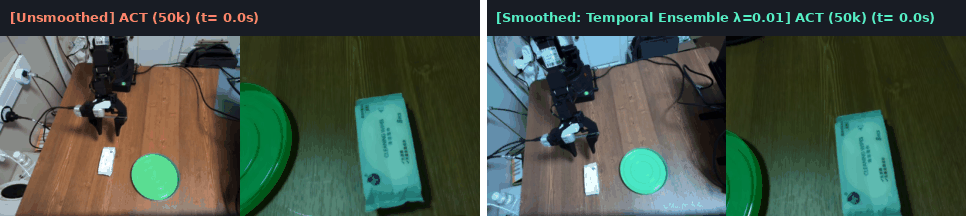
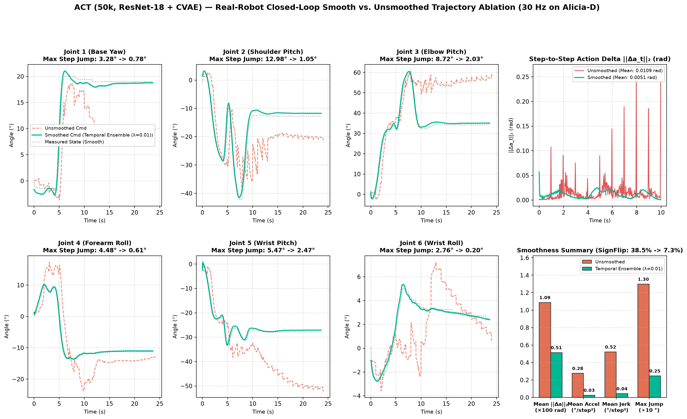

# ACT (Action Chunking with Transformers) — Alicia-D Real-Robot Deep Dive

[⬅️ 返回总览对比 (Back to Main Benchmark README)](../README.md)

---

## 1. 模型架构与配置概览 (Architecture & Training Spec)

| 属性 (Property) | 规格配置 (Specification) |
| :--- | :--- |
| **生成范式 (Generative Paradigm)** | Conditional Variational Autoencoder (CVAE) + Transformer Encoder-Decoder ($L_1$ Regression) |
| **视觉主干 (Vision Backbone)** | Pretrained `ResNet-18` (ImageNet), 双视角输入 (`observation.images.top` + `observation.images.wrist`) |
| **参数量 (Total Parameters)** | `~84M` |
| **预测视野 (Chunk Size $K$)** | `50` 步 (`1.67s @ 30 Hz`) |
| **归一化策略 (Normalization)** | 状态与动作均采用 Z-Score (`MEAN_STD`) |
| **训练步数與硬件 (Training)** | `50,000` steps，`batch_size = 8`，单卡 `NVIDIA RTX 4090` |
| **单块推理延迟 (Chunk Latency)** | **`6.1 ms`** on RTX 4090 (`163.9 Hz`) / **`8.8 ms`** on RTX 3080 Laptop (`113.6 Hz`) |

---

## 2. 真机闭环平滑对比演示 (Unsmoothed vs. Exponential Temporal Ensembling $\lambda=0.01$)

左半部分为 **无平滑开环分块执行 (`n_action_steps = 30`, `temporal_ensemble_coeff = 0`)**，右半部分为 **指数时序加权平滑 (`n_action_steps = 1`, `temporal_ensemble_coeff = 0.01`)**：

  
  
<em>图 1：ACT (50k) 真机闭环同步对比动图（左：无平滑分块执行，块切换处存在明显顿挫；右：指数时序集成 λ=0.01，全流程平滑抓取并放入绿盘）。</em>

---

## 3. 真机闭环轨迹与平滑度定量消融 (Quantitative Smoothness Ablation)

当 `ACT` 采用开环分块执行（每 `30` 步重新推理一次）时，由于相邻块在不同时刻的图像观测下独立解码，块边界处会产生高达 **`12.98°/step`** 的瞬时关节跳变（1 Hz 周期性机械顿挫）。开启指数时序加权集成（`ACTTemporalEnsembler`，$w_i = \exp(-0.01 \cdot i)$）后，每步融合过去 50 个历史预测块的当前时刻动作，完全消除了块边界断层：

  
  
<em>图 2：ACT (50k) 六轴真机轨迹、步间动作变化 ||Δa_t||₂ 以及平滑度四维指标对比（No-Smooth vs. Temporal Ensembling λ=0.01）。</em>

| 评测配置 (Evaluation Mode) | 轨迹帧数 $N$ | 步间变化均值 $\|\Delta a_t\|_2$ (rad) $\downarrow$ | 95分位 $\|\Delta a_t\|_2$ (rad) $\downarrow$ | 平均角加速度 (°/step²) $\downarrow$ | 平均加加速度 Jerk (°/step³) $\downarrow$ | 速度符号翻转率 (SignFlip) $\downarrow$ | 最大单步跳变 (MaxJump) $\downarrow$ | 真机任务成功率 |
| :--- | :---: | :---: | :---: | :---: | :---: | :---: | :---: | :---: |
| **ACT 无平滑 (`n_action_steps=30`)** | 726 | 0.0109 | 0.0349 | 0.2765 | 0.5212 | 38.5% | 12.98° | 100% (伴随块边界剧烈顿挫) |
| **ACT 指数时序平滑 ($\lambda=0.01$)** | 710 | **0.0051 (-53%)** | **0.0201 (-42%)** | **0.0259 (-91%)** | **0.0433 (-92%)** | **7.3%** | **2.47° (-81%)** | **100% (极度柔顺平滑)** |

---

## 4. 黄金抓取段开环跟踪误差分项 (Open-Loop Tracking Breakdown)

在 `wipes-to-green-plate-01` 黄金抓取段（Frames 150–300, 5.0s @ 30 Hz）上的各关节误差：

| Joint 1 (Base) | Joint 2 (Shoulder) | Joint 3 (Elbow) | Joint 4 (Forearm) | Joint 5 (Wrist Pitch) | Joint 6 (Wrist Roll) | **6轴平均 MAE** | **6轴 RMSE** | **夹爪 MAE (0–1000)** |
| :---: | :---: | :---: | :---: | :---: | :---: | :---: | :---: | :---: |
| 1.855° | 3.746° | 2.668° | 1.320° | 1.300° | 0.931° | **1.970°** | **2.660°** | **90.02** |

---

## 5. 本目录文件与复现命令 (Files & Reproducibility)

- [`train_act_4090.sh`](./train_act_4090.sh)：单卡 RTX 4090 训练脚本（50,000 steps）
- [`eval_act_smooth.sh`](./eval_act_smooth.sh)：真机闭环评测（开启指数时序集成 $\lambda=0.01$）
- [`eval_act_no_smooth.sh`](./eval_act_no_smooth.sh)：真机闭环评测（无平滑对照基线）
