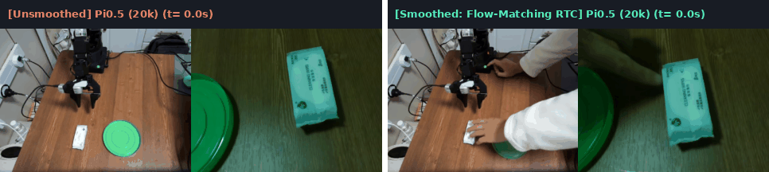
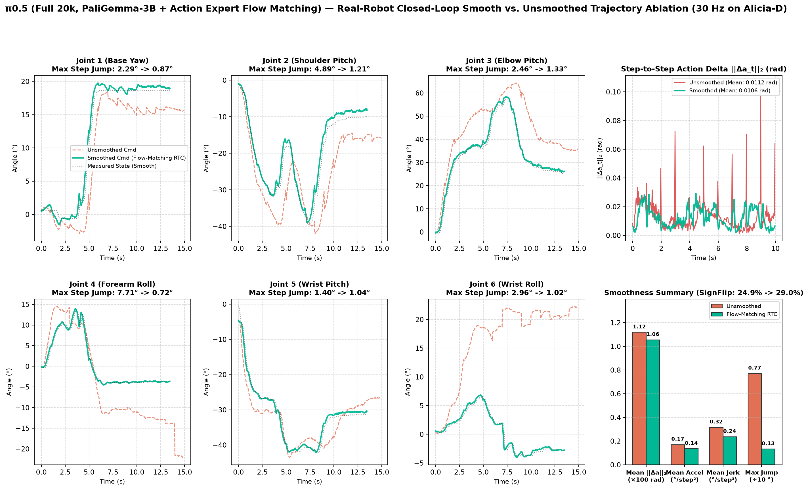

# $\pi_{0.5}$ (3.3B PaliGemma + Flow-Matching Action Expert) — Alicia-D Real-Robot Deep Dive

[⬅️ 返回总览对比 (Back to Main Benchmark README)](../README.md)

---

## 1. 模型架构与配置概览 (Architecture & Training Spec)

| 属性 (Property) | 规格配置 (Specification) |
| :--- | :--- |
| **生成范式 (Generative Paradigm)** | Flow Matching ODE (`10` Euler Steps) + Prefix-Conditioned Action Expert (`300M`) |
| **多模态主干 (VLM Backbone)** | `PaliGemma-3B` (`SigLIP-So400m` 视觉编码器 + `Gemma-2B` 语言主干) |
| **参数量 (Total Parameters)** | `~3.3B` |
| **相机键名重映射 (Camera Slot Mapping)** | `top -> base_0_rgb`，`wrist -> left_wrist_0_rgb`（自动零掩码填充 `right_wrist_0_rgb`） |
| **归一化策略 (Normalization)** | 分位数归一化 `QUANTILES [q01, q99]` |
| **训练方案 (Training Recipes)** | (1) `NVIDIA A800 80GB` 全量微调 `20,000` steps；(2) `RTX 4090 24GB` LoRA 微调 + 零开销权重合并 ([`merge_pi05_lora.py`](./merge_pi05_lora.py)) |
| **单块推理延迟 (Chunk Latency)** | **`112.0 ms`** on RTX 4090 (`8.9 Hz`) / **`294.7 ms`** on RTX 3080 Laptop (`3.4 Hz`) |

---

## 2. 真机闭环平滑对比演示 (Unsmoothed vs. Flow-Matching Real-Time Chunking)

由于 $\pi_{0.5}$ 参数量高达 `3.3B` 且需执行 10 步 Euler ODE 去噪，在本地 RTX 3080 控制机上每次重规划耗时约 `295 ms`（相当于 `30 Hz` 控制环停顿约 9 帧）。左半部分 **无平滑分块执行 (`use_rtc = false`)** 在块切换瞬间出现了高达 **`7.71°`** 的剧烈关节阶跃；右半部分 **启用 Flow-Matching RTC (`use_rtc = true`)** 后，利用上一块剩余前缀在去噪流场中进行连续性引导，将块边界最大跳变大幅压降至 **`1.33°`（降低 83%）**：

  
  
<em>图 1：π0.5 (Full 20k) 真机闭环同步对比动图（左：无平滑分块执行，受 295ms 重规划停顿影响存在块间跳变；右：启用 Flow-Matching RTC 前缀引导，消除块间阶跃并提前 1.4 秒完成放置）。</em>

---

## 3. 真机闭环轨迹与平滑度定量消融 (Quantitative Smoothness Ablation)

  
  
<em>图 2：π0.5 (Full 20k) 六轴真机轨迹、步间动作变化尖峰抑制（右上：红色尖峰被绿色 RTC 完全削平）及四维平滑指标对比。</em>

| 评测配置 (Evaluation Mode) | 轨迹帧数 $N$ | 步间变化均值 $\|\Delta a_t\|_2$ (rad) $\downarrow$ | 95分位 $\|\Delta a_t\|_2$ (rad) $\downarrow$ | 平均角加速度 (°/step²) $\downarrow$ | 平均加加速度 Jerk (°/step³) $\downarrow$ | 速度符号翻转率 (SignFlip) $\downarrow$ | 最大单步跳变 (MaxJump) $\downarrow$ | 真机任务成功率 |
| :--- | :---: | :---: | :---: | :---: | :---: | :---: | :---: | :---: |
| **$\pi_{0.5}$ 无平滑 (`n_action_steps=15`)** | 448 (`14.9s`) | 0.0112 | 0.0262 | 0.1706 | 0.3163 | 24.9% | 7.71° | 100% (存在 `7.71°` 块边界阶跃冲击) |
| **$\pi_{0.5}$ + Flow-Matching RTC (`smooth`)** | **405 (`13.5s`)** | **0.0106 (-5%)** | **0.0228 (-13%)** | **0.1357 (-20%)** | **0.2364 (-25%)** | 29.0% | **1.33° (-83%)** | **100% (彻底消除块间阶跃冲击)** |

---

## 4. 黄金抓取段开环跟踪误差分项 (Open-Loop Tracking Breakdown)

| Joint 1 (Base) | Joint 2 (Shoulder) | Joint 3 (Elbow) | Joint 4 (Forearm) | Joint 5 (Wrist Pitch) | Joint 6 (Wrist Roll) | **6轴平均 MAE** | **6轴 RMSE** | **夹爪 MAE (0–1000)** |
| :---: | :---: | :---: | :---: | :---: | :---: | :---: | :---: | :---: |
| 1.213° | 1.448° | 1.347° | 1.116° | 1.148° | 0.870° | **1.190°** | **1.547°** | **44.36** |

---

## 5. 本目录文件与复现命令 (Files & Reproducibility)

- [`train_pi05_a800_full.sh`](./train_pi05_a800_full.sh)：`A800 80GB` 全参数微调脚本（20,000 steps）
- [`train_pi05_4090_lora.sh`](./train_pi05_4090_lora.sh)：`RTX 4090 24GB` 单卡 LoRA 微调脚本
- [`merge_pi05_lora.py`](./merge_pi05_lora.py)：PEFT LoRA 权重合入基座并打包归一化统计量脚本
- [`eval_pi05_smooth.sh`](./eval_pi05_smooth.sh)：真机闭环评测（启用 Flow-Matching RTC）
- [`eval_pi05_no_smooth.sh`](./eval_pi05_no_smooth.sh)：真机闭环评测（无平滑对照基线）
