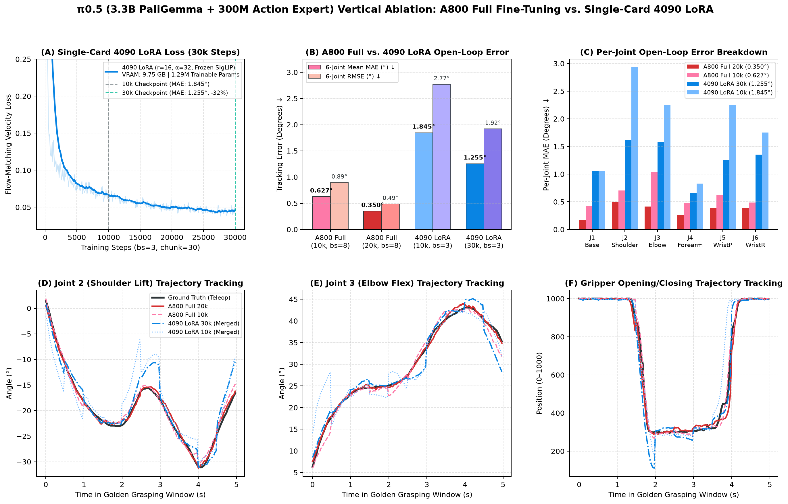

# $\pi_{0.5}$ (3.3B PaliGemma + Flow-Matching Action Expert) — Alicia-D Real-Robot Deep Dive

[⬅️ 返回总览对比 (Back to Main Benchmark README)](../README.md)

---

## 1. 模型架构与配置概览 (Architecture & Training Spec)

| 属性 (Property) | 规格配置 (Specification) |
| :--- | :--- |
| **生成范式 (Generative Paradigm)** | Flow Matching ODE (`10` Euler Steps) + Prefix-Conditioned Action Expert (`300M`) |
| **多模态主干 (VLM Backbone)** | `PaliGemma-3B` (`SigLIP-So400m` 视觉编码器 + `Gemma-2B` 语言主干) |
| **参数量 (Total Parameters)** | `~3.3B` |
| **相机键名重映射 (Camera Slot Mapping)** | `top -> base_0_rgb`，`wrist -> left_wrist_0_rgb`（自动零掩码填充 `right_wrist_0_rgb`） |
| **归一化策略 (Normalization)** | 分位数归一化 `QUANTILES [q01, q99]` |
| **训练方案 (Training Recipes)** | (1) `NVIDIA A800 80GB` 全量微调 `20,000` steps；(2) `RTX 4090 24GB` LoRA 微调 + 零开销权重合并 ([`merge_pi05_lora.py`](./merge_pi05_lora.py)) |
| **单块推理延迟 (Chunk Latency)** | **`112.0 ms`** on RTX 4090 (`8.9 Hz`) / **`294.7 ms`** on RTX 3080 Laptop (`3.4 Hz`) |

---

## 2. 真机闭环平滑对比演示 (Unsmoothed vs. Flow-Matching Real-Time Chunking)

由于 $\pi_{0.5}$ 参数量高达 `3.3B` 且需执行 10 步 Euler ODE 去噪，在本地 RTX 3080 边缘推理端上每次重规划耗时约 `295 ms`（相当于 `30 Hz` 推理周期等待约 9 帧）。左半部分 **无平滑分块执行 (`use_rtc = false`)** 在块切换瞬间出现了高达 **`7.71°`** 的明显动作跳变；右半部分 **启用 Flow-Matching RTC (`use_rtc = true`)** 后，利用上一块剩余前缀在去噪流场中进行连续性引导，将块边界最大跳变大幅压降至 **`1.33°`（降低 83%）**：

  
  
<em>图 1：π0.5 (Full 20k) 真机闭环同步对比动图（左：无平滑分块执行，受 295ms 重规划推理延迟影响存在块间跳变；右：启用 Flow-Matching RTC 前缀引导，消除块间跳变并提前 1.4 秒完成放置）。</em>

---

## 3. 真机闭环动作序列与平滑度定量消融 (Quantitative Smoothness Ablation)

  
  
<em>图 2：π0.5 (Full 20k) 六轴动作序列、步间动作变化尖峰抑制（右上：红色跳变峰被绿色 RTC 完全削平）及动作一致性四维指标对比。</em>

| 评测配置 (Evaluation Mode) | 帧数 $N$ | 步间变化均值 $\lVert \Delta a_t \rVert_2$ (rad) $\downarrow$ | 95分位 $\lVert \Delta a_t \rVert_2$ (rad) $\downarrow$ | 二阶动作曲率 $\lvert \Delta^2 a_t \rvert$ (°/step²) $\downarrow$ | 三阶动作抖动 `MeanJerk` (°/step³) $\downarrow$ | 方向翻转率 (`SignFlip`) $\downarrow$ | 最大单步跳变 (`MaxJump`) $\downarrow$ | 真机表现 |
| :--- | :---: | :---: | :---: | :---: | :---: | :---: | :---: | :---: |
| **$\pi_{0.5}$ 无平滑 (`n_action_steps=15`)** | 448 (`14.9s`) | 0.0112 | 0.0262 | 0.1706 | 0.3163 | 24.9% | 7.71° | **成功**（存在 `7.71°` 块边界跳变） |
| **$\pi_{0.5}$ + Flow-Matching RTC (`smooth`)** | **405 (`13.5s`)** | **0.0106 (-5%)** | **0.0228 (-13%)** | **0.1357 (-20%)** | **0.2364 (-25%)** | 29.0% | **1.33° (-83%)** | **成功（彻底消除块间跳变）** |

---

## 4. A800 全量微调 vs. 单卡 RTX 4090 LoRA 纵向消融 (Full Fine-Tuning vs. 4090 LoRA Vertical Ablation)

为探究 `3.3B` 规模的 **Mixture-of-Transformers (MoT)** 架构（`PaliGemma-3B` + `300M Action Expert`）在单卡消费级显存（`RTX 4090 24GB`）与数据中心级大显存（`A800 80GB`）下的微调边界，我们对比了四组纵向检查点：

  
  
<em>图 3：π0.5 纵向消融对比（左上：单卡 4090 冻结 SigLIP + LoRA 30k 步训练收敛曲线；中上/右上：A800 Full 10k/20k 与 4090 LoRA 10k/30k 开环六轴误差对比；下排：肩关节、肘关节与夹爪动作预测拟合对比）。</em>

| 纵向变体 (Variant) | 硬件与批大小 (Hardware & Batch) | 可训练参数 (Trainable Params) | 训练峰值显存 (Peak VRAM) | 训练步数 (Steps) | **6轴平均 MAE (°)** $\downarrow$ | **6轴 RMSE (°)** $\downarrow$ | **夹爪 MAE (0–1000)** $\downarrow$ | 离线合并后权重体积 |
| :--- | :---: | :---: | :---: | :---: | :---: | :---: | :---: | :---: |
| **`Full 10k`（全量微调）** | `A800 80GB` (`bs=8`) | `3.30B` (`100%`) | `~48.5 GB` | 10,000 | 0.627° | 0.895° | **11.95** | 9.35 GB |
| **`Full 20k`（全量微调，最优）** | `A800 80GB` (`bs=8`) | `3.30B` (`100%`) | `~48.5 GB` | 20,000 | **0.350°** (`n_act=15`) / **0.382°** (`n_act=30`) | **0.486°** | 17.03 | 9.35 GB |
| **`4090 LoRA 10k`（冻结 SigLIP + LoRA 合并）** | `RTX 4090 24GB` (`bs=3`) | **`1.29M` (`0.03%`)** | **`9.75 GB`** | 10,000 | 1.845° | 2.771° | 37.80 | **8.29 GB** |
| **`4090 LoRA 30k`（冻结 SigLIP + LoRA 合并）** | `RTX 4090 24GB` (`bs=3`) | **`1.29M` (`0.03%`)** | **`9.75 GB`** | 30,000 | **1.255° (-32%)** | **1.919° (-31%)** | **30.02** | **8.29 GB** |

### 核心机制剖析 (Key Mechanistic Takeaways)
1. **单卡 24GB 显存突围与零开销合并**：通过 `freeze_vision_encoder=True`（冻结 `SigLIP-So400m` 视觉塔）+ `bfloat16` + 梯度检查点 + `PEFT LoRA (r=16, α=32)`，仅微调 **`1.29M`（`0.03%`）** 参数即可将训练峰值显存压至 **`9.75 GB`**（相比全量微调降低 **80%**）；配合 [`merge_pi05_lora.py`](./merge_pi05_lora.py) 离线执行 $W_{\text{merged}} = W_0 + \frac{\alpha}{r}BA$ 合并，使推理延迟与原生基座完全一致（无 PEFT 旁路转发开销）。
2. **流匹配梯度方差与动作专家容量瓶颈**：由于流匹配每个样本独立采样时间步 $\tau \sim \text{Beta}(1.5, 1.0)$ 与高斯噪声 $\epsilon$，`bs=3` 下的随机速度场梯度方差高于 `bs=8`，将训练步数由 `10k` 延长至 `30k` 可使 `4090 LoRA` 开环误差显著下降 **32%**（`1.845° → 1.255°`）；同时，由于低秩旁路仅作用于注意力投影层而未放开 `300M Action Expert` 的 MLP 与 `adaRMSNorm` 调制层，在拟合高非线性关节轨迹时全量微调（`Full 20k: 0.350°`）仍具备显著精度优势。

---

## 5. 黄金抓取段开环动作预测误差分项 (Per-Joint Open-Loop Prediction Error Breakdown)

| 纵向变体 (Variant) | Joint 1 (Base) | Joint 2 (Shoulder) | Joint 3 (Elbow) | Joint 4 (Forearm) | Joint 5 (Wrist Pitch) | Joint 6 (Wrist Roll) | **6轴平均 MAE** | **6轴 RMSE** | **夹爪 MAE (0–1000)** |
| :--- | :---: | :---: | :---: | :---: | :---: | :---: | :---: | :---: | :---: |
| **`A800 Full 20k` (`n_act=15`)** | **0.163°** | **0.499°** | **0.412°** | **0.257°** | **0.382°** | **0.384°** | **0.350°** | **0.486°** | 17.03 |
| **`A800 Full 20k` (`n_act=30`)** | 0.245° | 0.555° | 0.562° | 0.278° | 0.361° | 0.292° | **0.382°** | **0.518°** | 19.23 |
| **`A800 Full 10k` (`n_act=15`)** | 0.428° | 0.704° | 1.041° | 0.475° | 0.626° | 0.486° | 0.627° | 0.895° | **11.95** |
| **`4090 LoRA 30k Merged`** | 1.061° | 1.622° | 1.574° | 0.662° | 1.260° | 1.352° | 1.255° | 1.919° | 30.02 |
| **`4090 LoRA 10k Merged`** | 1.064° | 2.932° | 2.247° | 0.829° | 2.244° | 1.754° | 1.845° | 2.771° | 37.80 |

---

## 6. 本目录文件与评测命令 (Files & Evaluation)

- [`merge_pi05_lora.py`](./merge_pi05_lora.py)：PEFT LoRA 权重零开销合入基座并打包分位数归一化统计量脚本
- [`eval_pi05_smooth.sh`](./eval_pi05_smooth.sh)：真机闭环评测（启用 Flow-Matching RTC）
- [`eval_pi05_no_smooth.sh`](./eval_pi05_no_smooth.sh)：真机闭环评测（无平滑对照基线）
