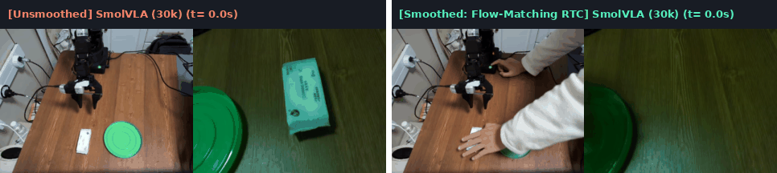
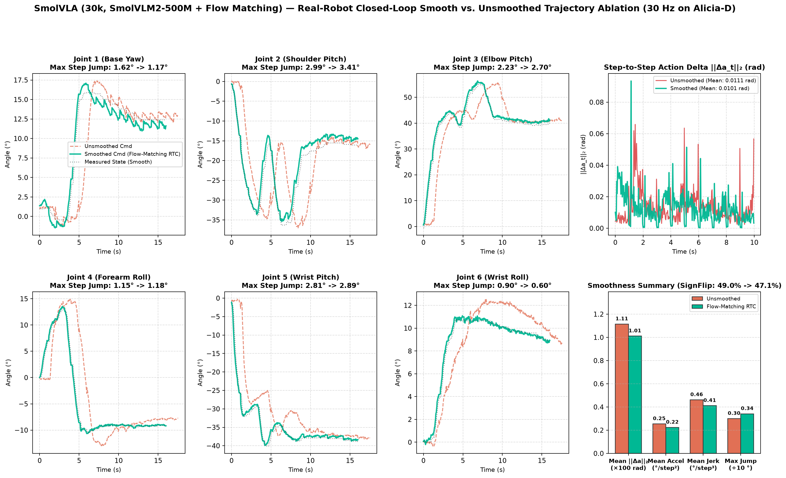
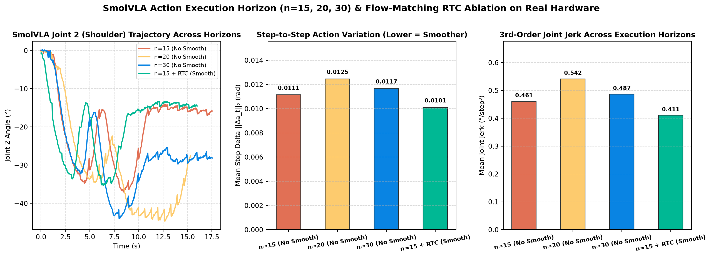

# SmolVLA (Compact 450M Flow-Matching VLA) — Alicia-D Real-Robot Deep Dive

[⬅️ 返回总览对比 (Back to Main Benchmark README)](../README.md)

---

## 1. 模型架构与配置概览 (Architecture & Training Spec)

| 属性 (Property) | 规格配置 (Specification) |
| :--- | :--- |
| **生成范式 (Generative Paradigm)** | Conditional Flow Matching (10-Step Euler ODE Action Expert) |
| **多模态主干 (VLM Backbone)** | `SmolVLM2-500M` (视觉编码器 + 语言指令联合表征) |
| **参数量 (Total Parameters)** | `~450M` |
| **相机键名重映射 (Camera Slot Mapping)** | `observation.images.top -> camera1`，`observation.images.wrist -> camera2` |
| **预测视野 (Chunk Size $K$)** | `30` 步 (`1.0s @ 30 Hz`) |
| **训练步数与硬件 (Training)** | `30,000` steps，`batch_size = 64`，单卡 `NVIDIA RTX 4090` |
| **单块推理延迟 (Chunk Latency)** | **`56.3 ms`** on RTX 4090 (`17.8 Hz`) / **`124.2 ms`** on RTX 3080 Laptop (`8.1 Hz`) |

---

## 2. 真机闭环平滑对比演示 (Unsmoothed vs. Flow-Matching Real-Time Chunking)

左半部分为 **无平滑开环分块执行 (`n_action_steps = 15`, `use_rtc = false`)**，右半部分为 **流匹配实时分块引导 (`n_action_steps = 15`, `use_rtc = true`, `RTCAttentionSchedule.ONES`)**：

  
  
<em>图 1：SmolVLA (30k) 真机闭环同步对比动图（左：无平滑开环块执行；右：启用 Flow-Matching RTC 前缀引导平滑，更快更稳地完成抓取与绿盘放置）。</em>

---

## 3. 真机闭环轨迹与执行视野消融 (RTC Smoothing & Execution Horizon Ablation)

针对 `SmolVLA` 的 10 步 Euler ODE 采样器，我们在真机上完成了两组核心消融实验：
1. **Flow-Matching RTC 前缀引导消融 (`eval_smolvla_no_smooth` vs. `eval_smolvla_smooth`)**：在 ODE 积分过程中引入上一预测块未执行完的前缀引导约束，使步间动作变化 $\|\Delta a_t\|_2$ 降低 **9%** (`0.0111 -> 0.0101 rad`)，三阶加加速度 `MeanJerk` 降低 **11%** (`0.4609 -> 0.4108 °/step³`)，任务总耗时从 `527` 帧 (`17.6s`) 缩短至 **`481` 帧 (`16.0s`)**。
2. **开环执行步长消融 (`n_action_steps = 15 vs. 20 vs. 30`)**：对比不同重规划周期下的真机轨迹平滑度与下探抓取深度。

  
  
<em>图 2：SmolVLA (30k) 六轴真机轨迹、步间动作变化 ||Δa_t||₂ 及平滑度指标对比（No-Smooth vs. Flow-Matching RTC）。</em>

  
  
<em>图 3：SmolVLA 不同开环执行视野（n=15, n=20, n=30）与 Flow-Matching RTC 的真机轨迹与 Jerk 对比。</em>

| 评测配置 (Evaluation Mode) | 执行步长 `n_action_steps` | 轨迹帧数 $N$ | 步间变化均值 $\|\Delta a_t\|_2$ (rad) $\downarrow$ | 95分位 $\|\Delta a_t\|_2$ (rad) $\downarrow$ | 平均角加速度 (°/step²) $\downarrow$ | 平均加加速度 Jerk (°/step³) $\downarrow$ | 速度符号翻转率 (SignFlip) $\downarrow$ | 最大单步跳变 (MaxJump) $\downarrow$ | 真机表现 |
| :--- | :---: | :---: | :---: | :---: | :---: | :---: | :---: | :---: | :---: |
| **SmolVLA 无平滑 (`nk20`)** | 20 | 460 | 0.0125 | 0.0300 | 0.2947 | 0.5415 | 46.3% | 3.63° | **成功** |
| **SmolVLA 无平滑 (`nk30`)** | 30 | 527 | 0.0117 | 0.0293 | 0.2695 | 0.4865 | 47.1% | 3.68° | **成功** |
| **SmolVLA 无平滑基线 (`no_smooth`)** | 15 | 527 | 0.0111 | 0.0279 | 0.2541 | 0.4609 | 49.0% | 2.99° | **成功** |
| **SmolVLA + Flow-Matching RTC (`smooth`)** | **15 (w/ RTC)** | **481** | **0.0101 (-9%)** | **0.0268 (-4%)** | **0.2237 (-12%)** | **0.4108 (-11%)** | **47.1%** | **3.41°** | **成功** |

---

## 4. 黄金抓取段开环跟踪误差分项 (Open-Loop Tracking Breakdown)

| Joint 1 (Base) | Joint 2 (Shoulder) | Joint 3 (Elbow) | Joint 4 (Forearm) | Joint 5 (Wrist Pitch) | Joint 6 (Wrist Roll) | **6轴平均 MAE** | **6轴 RMSE** | **夹爪 MAE (0–1000)** |
| :---: | :---: | :---: | :---: | :---: | :---: | :---: | :---: | :---: |
| 0.366° | 0.437° | 0.636° | 0.309° | 0.302° | 0.268° | **0.386°** | **0.501°** | **26.43** |

---

## 5. 本目录文件与复现命令 (Files & Reproducibility)

- [`train_smolvla_4090.sh`](./train_smolvla_4090.sh)：单卡 RTX 4090 训练脚本（30,000 steps，`batch_size=64`）
- [`eval_smolvla_smooth.sh`](./eval_smolvla_smooth.sh)：真机闭环评测（启用 Flow-Matching RTC）
- [`eval_smolvla_no_smooth.sh`](./eval_smolvla_no_smooth.sh)：真机闭环评测（无平滑对照基线）
