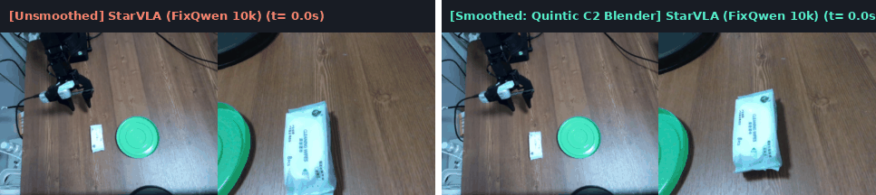
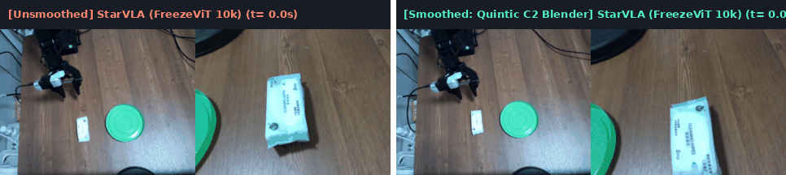
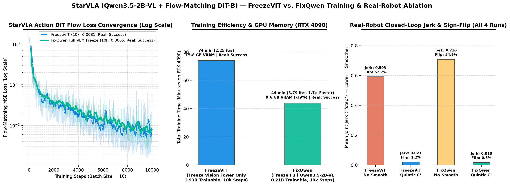
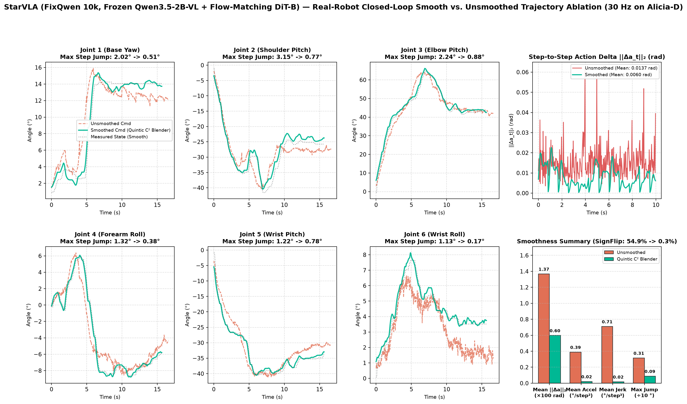
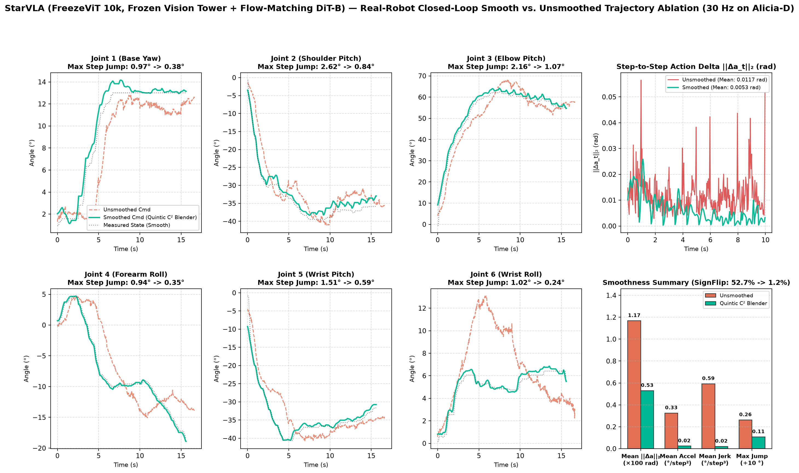

# StarVLA (Qwen3.5-2B-VL + GR00T Flow-Matching DiT-B) — Alicia-D 真机纵向深入消融 (`分比`)

[⬅️ 返回跨策略横向总览 (Back to Main Benchmark README)](../README.md)

---

## 1. 模型架构与配置概览

| 属性项 | 规格配置 |
| :--- | :--- |
| **策略框架** | `StarVLA` — `QwenGR00T` 架构（多模态视觉语言主干 + 扩散变换器动作头） |
| **多模态主干 (VLM Backbone)** | `Qwen3.5-2B-VL`（双视角 `320×240` 图像序列 + 自然语言指令联合编码，隐藏层维度 `2048`） |
| **动作生成网络 (Action Head)** | Conditional Flow-Matching `DiT-B`（16 层 Cross-Attention Transformer，隐藏层维度 `1024`，`10` 步 Euler ODE 采样） |
| **总参数量 / 可训练参数量** | 总计 `2.26B`；**`FreezeViT` 模式：`1.93B` 可训练** vs. **`FixQwen` 模式：仅 `209M` (`0.21B`) 可训练** |
| **预测视野 (Chunk Horizon $K$)** | `30` 步（对应 `30 Hz` 控制下的 `1.0s` 未来动作序列） |
| **动作与状态归一化** | 分位数截断归一化 (`q01` / `q99` 映射至 `[-1, 1]`，配置文件 [`dataset_statistics.json`](./dataset_statistics.json)) |
| **单块推理延迟 (Chunk Latency)** | **`115.0 ms`** on NVIDIA RTX 4090 (`8.7 Hz`) / **`491.3 ms`** on RTX 3080 Laptop (`2.0 Hz`) |
| **最优真机闭环配置** | **`FixQwen` (10k Steps) + `RecedingHorizonTrajectoryBlender` (五次多项式 $C^2$ 边界锚定平滑)** |

---

## 2. 真机闭环平滑对比实拍（`FixQwen` 与 `FreezeViT` 无平滑 vs. 五次多项式 $C^2$ 平滑）

在 Alicia-D 真机 30 Hz 闭环测试中，我们完成了 **`FixQwen (10k)`** 与 **`FreezeViT (10k)`** 在 **无平滑开环块执行 (`n_action_steps = 15`)** 与 **启用五次多项式 $C^2$ 边界锚定平滑 (`Quintic C² Blender`)** 下的全套 2×2 实机评测，四组实验真机表现均为**成功**：

### 2.1 `FixQwen (10k)`（冻结全部 Qwen3.5-2B-VL 主干）：无平滑 vs. 五次多项式 $C^2$ 平滑

  
  
<em>图 1：StarVLA (FixQwen 10k) 真机 30 Hz 闭环同步对比动图（左：无平滑开环块执行 eval_starvla_fixqwen_no_smooth；右：启用五次多项式 C² 边界平滑 eval_starvla_fixqwen_smooth，消除块内高频去噪抖动与块间阶跃，丝滑完成抓取与入盘）。</em>

### 2.2 `FreezeViT (10k)`（仅冻结视觉编码器塔）：无平滑 vs. 五次多项式 $C^2$ 平滑

  
  
<em>图 2：StarVLA (FreezeViT 10k) 真机 30 Hz 闭环同步对比动图（左：无平滑开环块执行 eval_starvla_freeze_vit_no_smooth；右：启用五次多项式 C² 边界平滑 eval_starvla_smooth）。</em>

---

## 3. 纵向对比一：仅冻结视觉塔 (`FreezeViT`) vs. 全冻结多模态主干 (`FixQwen`)

在 67 条轨迹（`24,535` 帧）的真机数据集上微调 `2.26B` 参数的 `StarVLA` 时，我们重点对比了两种主干冻结策略（单卡 **NVIDIA RTX 4090 24GB**，总步数 `10,000` 步，`batch_size = 16`）：

1. **`FreezeViT (10k)`（仅冻结视觉编码器塔）**：
   - 配置 `freeze_module: "qwen_vl_interface.model.model.visual"`（[`starvla_wipes_qwen3_5_2b_gr00t_freeze_vit.yaml`](./starvla_wipes_qwen3_5_2b_gr00t_freeze_vit.yaml)），仅冻结 `330M` 视觉编码器，放开 `1.72B` 的 `Qwen3.5` 语言模型主干与 `209M` 的 `DiT-B` 动作头（共 `1.93B` 可训练参数）。
2. **`FixQwen (10k)`（冻结全部 `Qwen3.5-2B-VL` 多模态主干 — 最优推荐）**：
   - 配置 `freeze_module: "qwen_vl_interface"`（[`starvla_wipes_qwen3_5_2b_gr00t_fixqwen.yaml`](./starvla_wipes_qwen3_5_2b_gr00t_fixqwen.yaml)），将 `Qwen3.5-2B-VL` 的视觉编码器与 2B 语言主干**全部冻结**，仅训练 `209M` 的流匹配 `ActionModel (DiT-B)` 与本体状态投影层。

  
  
<em>图 3：StarVLA 仅冻结视觉塔 (FreezeViT 10k) 与全冻结多模态主干 (FixQwen 10k) 的流匹配损失收敛曲线（左）、RTX 4090 训练耗时与显存占用对比（中）以及四组真机闭环评测的三阶加加速度 Jerk 与速度翻转率对比（右）。</em>

| 冻结策略变体 | `freeze_module` 配置 | 可训练参数量 | RTX 4090 训练速度 | 10k 步总耗时 | 峰值显存占用 | 最终流匹配 Loss | 黄金段开环 6轴 MAE | 真机表现 |
| :--- | :--- | :---: | :---: | :---: | :---: | :---: | :---: | :---: |
| **`FreezeViT (10k)`** | `...model.visual`（仅冻结视觉塔） | 1.93B (85.4%) | 2.25 step/s | 74.0 分钟 | 15.8 GB | 0.0081 | **0.543°** | **成功** |
| **`FixQwen (10k)`（最优配置）** | **`qwen_vl_interface`（全冻结 VLM）** | **0.21B (9.2%)** | **3.79 step/s (1.7×)** | **44.0 分钟 (-41%)** | **9.6 GB (-39%)** | **0.0065** | **0.639°** | **成功** |

### 核心实验发现
- **免除 2B LLM 反向传播，训练提速 1.7 倍、显存直降 39%**：在单任务真机操作中，语言指令固定不变，无需微调 `1.72B` 的自回归语言主干。`FixQwen` 将可训练参数压缩至 `209M`，使单卡 RTX 4090 训练时间从 `74 分钟` 缩短至 **`44 分钟`**，显存占用从 `15.8 GB` 降至 **`9.6 GB`**（甚至可在 12GB 消费级显卡上完成训练）。
- **更优的流匹配收敛与闭环平滑上限**：由于冻结的 `Qwen3.5-2B-VL` 提供了完全平稳的多模态条件键值表征 (`KV Cache`)，下游 `DiT-B` 动作头收敛至更低的流匹配损失 (`0.0065` vs. `0.0081`)，且在启用五次多项式 $C^2$ 平滑后取得了全场最低的速度符号翻转率 (**`0.3%`**) 与更小的最大单步跳变 (**`0.88°`**)。

---

## 4. 纵向对比二：真机闭环五次多项式 $C^2$ 平滑消融（四组真机实验全对比）

由于 `StarVLA` 的 `DiT-B` 动作头通过 10 步 Euler ODE 从高斯噪声采样生成 30 步动作块，直接开环执行 (`No-Smooth`) 时相邻时间步之间存在高频去噪微颤（`FreezeViT` 无平滑速度翻转率达 `52.7%`，`FixQwen` 无平滑达 `54.9%`）。为此，我们在 [`scripts/eval_alicia_starvla.py`](../scripts/eval_alicia_starvla.py) 中引入了 **`RecedingHorizonTrajectoryBlender`（块内因果高斯滤波 $\sigma=1.8$ + 前半块防回退夹紧 + 五次多项式 $C^2$ 边界锚定 $s(\tau)=10\tau^3-15\tau^4+6\tau^5$）**。

  
  
<em>图 4：StarVLA (FixQwen 10k) 在 Alicia-D 真机 30 Hz 闭环下的六轴轨迹、步间动作变化 ||Δa_t||₂ 及平滑度指标对比（eval_starvla_fixqwen_no_smooth vs. eval_starvla_fixqwen_smooth）。</em>

  
  
<em>图 5：StarVLA (FreezeViT 10k) 在 Alicia-D 真机 30 Hz 闭环下的六轴轨迹、步间动作变化 ||Δa_t||₂ 及平滑度指标对比（eval_starvla_freeze_vit_no_smooth vs. eval_starvla_smooth）。</em>

| 策略变体与闭环模式 | 真机评测目录 (`eval_runs/local/`) | 轨迹帧数 $N$ | 步间变化均值 $\|\Delta a_t\|_2$ (rad) $\downarrow$ | 95分位 $\|\Delta a_t\|_2$ (rad) $\downarrow$ | 平均角加速度 (°/step²) $\downarrow$ | 平均加加速度 Jerk (°/step³) $\downarrow$ | 速度符号翻转率 (SignFlip) $\downarrow$ | 最大单步跳变 (MaxJump) $\downarrow$ | 真机表现 |
| :--- | :--- | :---: | :---: | :---: | :---: | :---: | :---: | :---: | :---: |
| **`FreezeViT (10k)` 无平滑** | `eval_starvla_freeze_vit_no_smooth` | 500 (`16.7s`) | 0.0117 | 0.0251 | 0.3253 | 0.5927 | 52.7% | 2.62° | **成功** |
| **`FreezeViT (10k)` + 五次多项式 $C^2$ 平滑** | `eval_starvla_smooth` | **469 (`15.6s`)** | **0.0053 (-55%)** | **0.0151 (-40%)** | **0.0237 (-93%)** | **0.0208 (-96%)** | **1.2%** | **1.07° (-59%)** | **成功** |
| **`FixQwen (10k)` 无平滑** | `eval_starvla_fixqwen_no_smooth` | 499 (`16.6s`) | 0.0137 | 0.0260 | 0.3893 | 0.7096 | 54.9% | 3.15° | **成功** |
| **`FixQwen (10k)` + 五次多项式 $C^2$ 平滑** | `eval_starvla_fixqwen_smooth` | **470 (`15.7s`)** | **0.0060 (-56%)** | **0.0157 (-40%)** | **0.0212 (-95%)** | **0.0179 (-97%)** | **0.3%** | **0.88° (-72%)** | **成功** |

---

## 5. 黄金抓取段开环跟踪误差分项（Frame 150–300，5.0s @ 30 Hz）

| 策略变体 | Joint 1 (底座) | Joint 2 (肩部) | Joint 3 (肘部) | Joint 4 (前臂) | Joint 5 (腕俯仰) | Joint 6 (腕横滚) | **6轴平均 MAE** $\downarrow$ | **6轴 RMSE** $\downarrow$ | **夹爪 MAE (0–1000)** $\downarrow$ |
| :--- | :---: | :---: | :---: | :---: | :---: | :---: | :---: | :---: | :---: |
| **`StarVLA (FreezeViT 10k)`** | 0.487° | 0.633° | 0.645° | 0.416° | 0.521° | 0.555° | **0.543°** | **0.737°** | 17.18 |
| **`StarVLA (FixQwen 10k)`** | 0.515° | 0.699° | 0.969° | 0.533° | 0.691° | 0.429° | **0.639°** | **0.889°** | **16.90** |

---

## 6. 本目录文件与复现命令

- [`starvla_wipes_qwen3_5_2b_gr00t_fixqwen.yaml`](./starvla_wipes_qwen3_5_2b_gr00t_fixqwen.yaml) & [`run_wipes_fixqwen_4090.sh`](./run_wipes_fixqwen_4090.sh)：`FixQwen` 全冻结 VLM 训练配置与启动脚本（10,000 steps，RTX 4090）
- [`starvla_wipes_qwen3_5_2b_gr00t_freeze_vit.yaml`](./starvla_wipes_qwen3_5_2b_gr00t_freeze_vit.yaml) & [`run_wipes_freeze_vit_4090.sh`](./run_wipes_freeze_vit_4090.sh)：`FreezeViT` 仅冻结视觉塔训练配置与启动脚本（10,000 steps，RTX 4090）
- [`dataset_statistics.json`](./dataset_statistics.json)：`wipes-to-green-plate-01` 数据集 `q01/q99/mean/std` 统计文件
- [`eval_starvla_smooth.sh`](./eval_starvla_smooth.sh)：真机闭环评测（启用五次多项式 $C^2$ 平滑）
- [`eval_starvla_no_smooth.sh`](./eval_starvla_no_smooth.sh)：真机闭环评测（无平滑开环对照基线）
