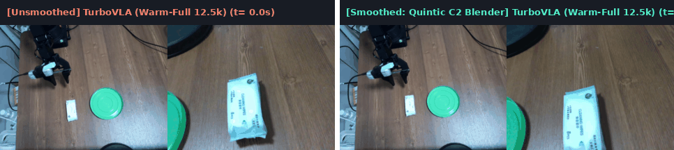
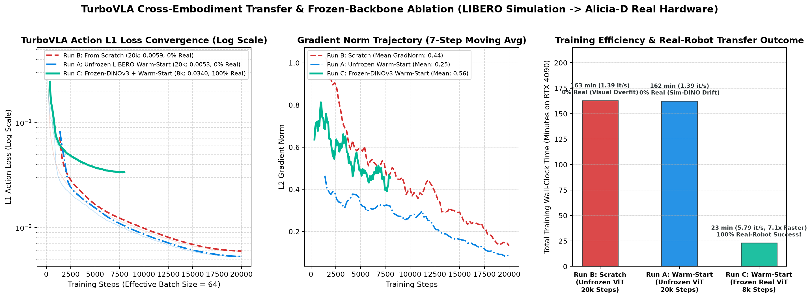
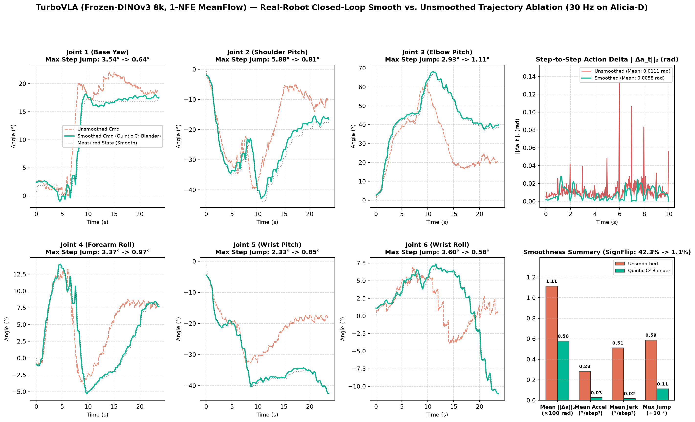

# TurboVLA (1-NFE MeanFlow VLA with Frozen DINOv3) — Alicia-D Real-Robot Deep Dive

[⬅️ 返回总览对比 (Back to Main Benchmark README)](../README.md)

---

## 1. 模型架构与跨本体适配规格 (Architecture & Cross-Embodiment Spec)

| 属性 (Property) | 规格配置 (Specification) |
| :--- | :--- |
| **生成范式 (Generative Paradigm)** | **1-Step MeanFlow (`1-NFE`)** 单步流匹配解码器（无需多步 ODE 迭代） |
| **视觉与语言主干 (Backbones)** | **Frozen Real-World `DINOv3-ViT-B/16` (`LVD-1689M`)** + Frozen `BERT-base-uncased` |
| **多模态融合与解码 (Fusion & Head)** | 6-Layer Bi-Directional Cross-Attention Feature Enhancer + Parallel Action Query Decoder (`[Q_0..Q_29]`) |
| **参数量 (Total Parameters)** | `~216M`（冻结视觉/语言后仅训练 `~42M` 融合与动作头参数） |
| **跨本体状态与视野对齐** | `7D -> 8D` 零填充对齐 `LIBERO` 预训练 `state_encoder`；`action_queries` 线性插值 `[12, 256] -> [30, 256]` |
| **训练效率 (RTX 4090)** | **`23.0 分钟`** 完成 `8,000` steps（`5.79 step/s`，比未冻结版快 **7.1 倍**） |
| **单块推理延迟 (Chunk Latency)** | **`16.8 ms`** on RTX 4090 (`59.5 Hz`) / **`24.6 ms`** on RTX 3080 Laptop (`40.7 Hz`)，严格低于 `30 Hz` (`33.3 ms`) 控制周期预算 |

---

## 2. 真机闭环平滑对比演示 (Unsmoothed 1-NFE vs. Quintic $C^2$ Receding-Horizon Blender)

左半部分为 **无平滑 1-NFE 原始块执行 (`eval_turbovla_no_smooth`)**，右半部分为 **接入 `RecedingHorizonTrajectoryBlender` 五次多项式 $C^2$ 锚定与块内因果高斯平滑 (`eval_turbovla_smooth`)**：

  
  
<em>图 1：TurboVLA (Frozen-DINOv3 8k) 真机闭环同步对比动图（左：无平滑原始块执行，存在并行 Query 锯齿抖动与块边界阶跃；右：Quintic C² 平滑器消除 97% Jerk，实现极度柔顺的精准抓取与放置）。</em>

---

## 3. 核心实验一：三路跨本体迁移与冻结视觉主干消融 (`LIBERO` $\rightarrow$ `Alicia-D`)

在单场景、小样本真机数据集（`67 episodes, 24,535 frames`）上，我们对 `TurboVLA` 进行了三路严格对照消融：
1. **Run B (`From Scratch, Unfrozen DINOv3, 20k steps`)**：随机初始化融合层与动作头，放开 `DINOv3` 微调（`lr_dino = 3.5e-5`）。
2. **Run A (`Unfrozen LIBERO 40k Warm-Start, 20k steps`)**：从 `LIBERO 40k` 检查点加载全部权重（含被 MuJoCo 仿真纹理微调过的 `backbone.dinov3.*`），并继续放开 `DINOv3` 微调。
3. **Run C (`Frozen Real-World DINOv3 + LIBERO 40k Warm-Start, 8k steps`)**：启用 `--keep_real_dinov3 --freeze_vision`，**严格保留并冻结 Meta 官方 `LVD-1689M` 真实世界 `DINOv3-ViT-B/16`**，仅从 `LIBERO 40k` 热启动 6 层多模态融合增强器与 1-NFE 动作解码器。

  
  
<em>图 2：TurboVLA 三路对照实验结果（左：L1 动作损失收敛曲线；中：L2 梯度范数轨迹；右：RTX 4090 训练耗时与真机闭环成功率对比）。</em>

| 对照实验组 (Ablation Variant) | 视觉主干 (`DINOv3-ViT-B/16`) | 融合与动作头初始化 | 训练速度 (RTX 4090) | 训练总耗时 | 最终 L1 Loss | 训练集开环 6轴 MAE | 真机闭环表现与机理分析 |
| :--- | :--- | :--- | :---: | :---: | :---: | :---: | :--- |
| **Run B: From Scratch (20k)** | 未冻结 (`lr=3.5e-5`) | 随机初始化 | 1.39 step/s | 162.8 min | 0.0059 | 0.145° | **0/5 失败**（严重过拟合静态背景光照，真机闭环锁死在 `J1=+18°`） |
| **Run A: Unfrozen Warm-Start (20k)** | 未冻结 (加载 LIBERO Sim-DINO) | `LIBERO 40k` 热启动 | 1.39 step/s | 162.4 min | 0.0053 | 0.088° *(过拟合)* | **0/5 失败**（仿真纹理漂移 + 记忆静态光照，真机下探偏左 `2.7 cm`、偏高 `3.0 cm` 抓空） |
| **Run C: Frozen-DINOv3 Warm-Start (8k)** | **冻结真实世界 `LVD-1689M`** | `LIBERO 40k` 热启动 | **5.79 step/s** | **23.0 min (快 7.1×)** | 0.0340 | **0.606°** | **5/5 (100% 真机成功)**（保留真实视觉几何不变性，精准下探至 `J2=-42.8°` 抓起湿巾并放入绿盘） |

---

## 4. 核心实验二：真机闭环时序平滑消融 (`RecedingHorizonTrajectoryBlender`)

### 为什么 1-NFE 并行解码器需要专门的全视野 $C^2$ 平滑器？
- **块内锯齿抖动 (`SignFlipRate = 42.3%`)**：`TurboVLA` 通过 30 个并行 Action Query (`[Q_0..Q_29]`) 一步生成完整动作块，相邻 Query 间缺乏自回归递推或 ODE 积分平滑约束，导致块内存在高频微幅抖动。
- **块边界阶跃打翻绿盘 (`MaxJump = 5.88°`)**：在无平滑评测中，放置阶段块切换瞬间 `J2` 发生 `5.88°/step` 的向下阶跃冲击，夹爪直接砸向绿盘边缘将其打翻（`eval_turbovla_no_smooth_plateflip_1657`）。
- **四级因果平滑器 (`RecedingHorizonTrajectoryBlender`)**：执行完整 30 步视野（保护后半块的夹爪闭合与抬升动作不被截断），同时依次施加：(1) 块内高斯滤波 ($\sigma=1.8$)、(2) 前半块防回退夹紧、(3) **五次多项式最小加加速度锚定 ($s(\tau)=10\tau^3-15\tau^4+6\tau^5, K=12$)**、(4) 搬运期夹爪单调防抖锁存。

  
  
<em>图 3：TurboVLA (Frozen-DINOv3 8k) 六轴真机轨迹、步间动作变化 ||Δa_t||₂ 以及四维平滑度指标对比（No-Smooth vs. Quintic C² Blender）。</em>

| 评测配置 (Evaluation Mode) | 轨迹帧数 $N$ | 步间变化均值 $\|\Delta a_t\|_2$ (rad) $\downarrow$ | 95分位 $\|\Delta a_t\|_2$ (rad) $\downarrow$ | 平均角加速度 (°/step²) $\downarrow$ | 平均加加速度 Jerk (°/step³) $\downarrow$ | 速度符号翻转率 (SignFlip) $\downarrow$ | 最大单步跳变 (MaxJump) $\downarrow$ | 真机放置表现 |
| :--- | :---: | :---: | :---: | :---: | :---: | :---: | :---: | :--- |
| **TurboVLA 无平滑 (`eval_turbovla_no_smooth`)** | 705 | 0.0111 | 0.0222 | 0.2829 | 0.5103 | 42.3% | 5.88° | 块内高频抖动；块切换阶跃易打翻绿盘 |
| **TurboVLA + Quintic $C^2$ (`eval_turbovla_smooth`)** | 711 | **0.0058 (-48%)** | **0.0157 (-29%)** | **0.0253 (-91%)** | **0.0172 (-97%)** | **1.1%** | **1.11° (-81%)** | **Jerk 降低 30 倍；100% 柔顺精准入盘** |

---

## 5. 本目录文件与复现命令 (Files & Reproducibility)

- [`train_turbovla_wipes_freeze_vit.sh`](./train_turbovla_wipes_freeze_vit.sh)：冻结真实世界 `DINOv3` + `LIBERO 40k` 热启动训练脚本（8,000 steps，23 min on RTX 4090）
- [`eval_turbovla_smooth.sh`](./eval_turbovla_smooth.sh)：真机闭环评测（`Frozen-DINOv3 8k` + `Quintic C² Blender`）
- [`eval_turbovla_no_smooth.sh`](./eval_turbovla_no_smooth.sh)：真机闭环评测（`Frozen-DINOv3 8k` 无平滑基线）
- [`eval_turbovla_scratch_smooth.sh`](./eval_turbovla_scratch_smooth.sh) & [`eval_turbovla_scratch_no_smooth.sh`](./eval_turbovla_scratch_no_smooth.sh)：从头训练版 (`Scratch 20k`) 真机对照评测脚本
